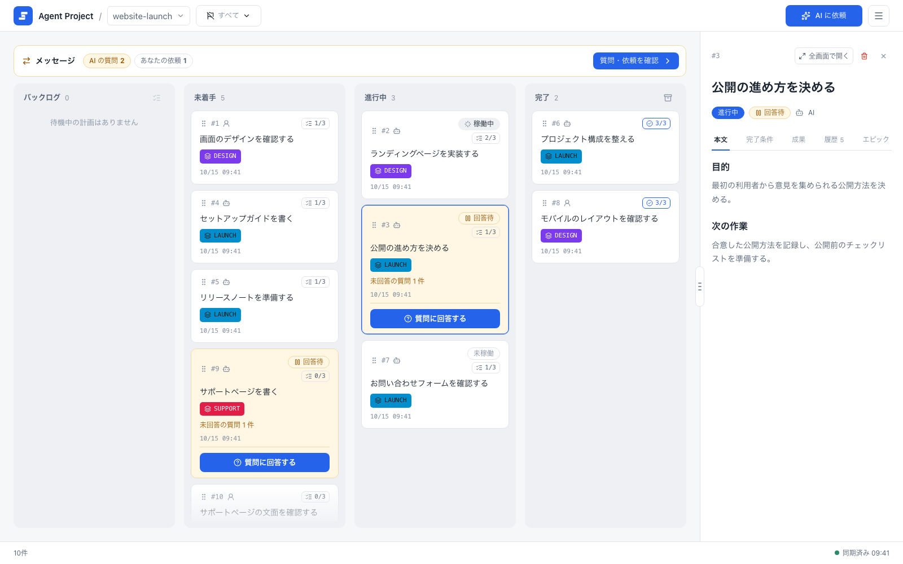
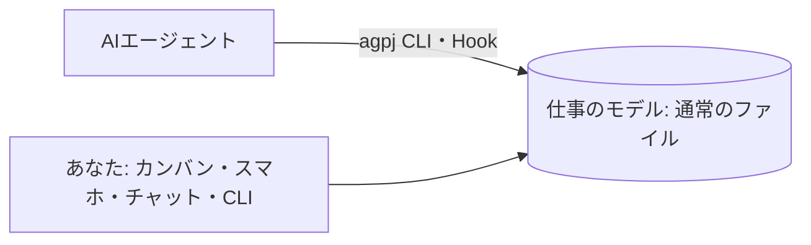
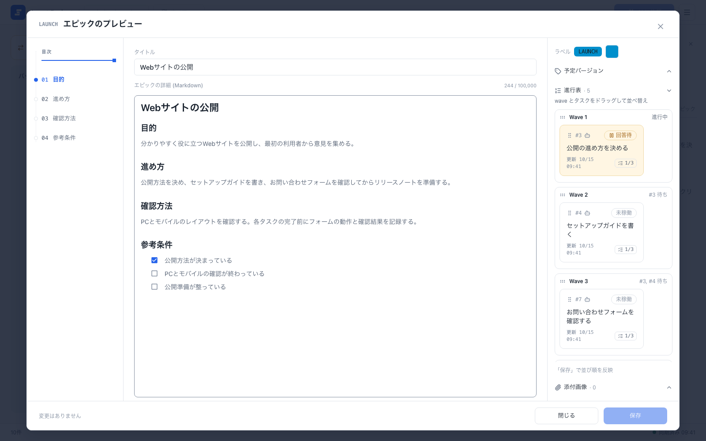
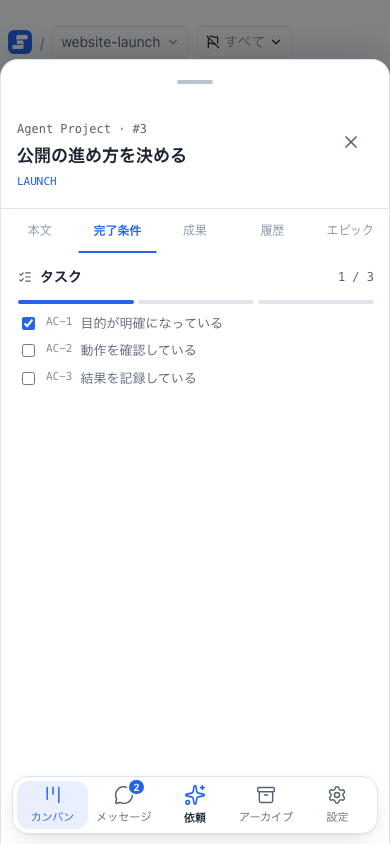

<div align="center">


# Agent Project

[](https://github.com/FooQoo/agent-project/actions/workflows/ci.yml) [](https://codecov.io/gh/FooQoo/agent-project)

**人が回さなくても、大きな仕事が進む。**

Agent Projectは、一人でプロダクトを育てる人が、大きな仕事を計画から検証までCodexやClaude Codeに任せるためのツールです。計画と進み具合はカンバンに並び、あなたの判断が要る質問はメッセージに届きます。この2つがあれば、付きっきりにならなくてもプロジェクトは進みます。

```sh
brew install fooqoo/tap/agpj
```

[English](README.md) · [デモを試す](https://fooqoo.github.io/agent-project/demo/) · [使い方](https://fooqoo.github.io/agent-project/ja/guide/) · [開発に参加する](CONTRIBUTING.ja.md) · [GitHubリポジトリ](https://github.com/FooQoo/agent-project)




</div>

## Agent Projectとは

AIエージェントは大きな仕事を引き受けられますが、長い仕事には、まだ誰かが回し役として付く必要があります。エージェントは途中で迷い、止まり、終わったつもりになり、あなたは計画を書き、ログに埋もれた質問を拾い、次のセッションで経緯を説明し直し、最後に本当に終わったかを確かめることになります。

Agent Projectは、エージェントに足りないプロジェクトマネジメントを与え、人が回さなくても仕事が進むようにします。Claude CodeやCodexのようなエージェントのそばに置くもので、エージェントを動かすことはしません。エージェントも人も読み書きできる記録が4つあります。

- **順番のある計画。** 目標がエピックとタスクに分かれ、次に進められる作業を、進行表がエージェントに伝えます。
- **終わりの定義。** タスクごとに、作業の前に決める完了条件です。
- **あなたへの質問。** 意図が分からない・好みで決まる・取り返しがつかない・範囲が広がる、のときは、エージェントが自分で決めず、止まって聞きます。
- **記録。** 履歴と結果に、やったことと決めたことが残るので、次のセッションや別のエージェントが、そこから始められます。

CodexやClaude Codeを使って一人でプロダクトを作っている人のためのものです。すべて手元の通常のファイルに保存され、アカウントやクラウドサービスは要りません。



実際に触ってみたい場合は、[デモ](https://fooqoo.github.io/agent-project/demo/)をブラウザで試せます。インストールは不要です。サンプルデータで初回の案内が始まり、ページを再読み込みすると最初からやり直せます。

## 任せる流れ

1. **AIに計画を頼む。** やりたいことを、普通の言葉でエージェントに伝えます。
2. **計画が置かれる。** エージェントが、完了条件つきのエピックとタスクをバックログに置き、自分では決められないことを質問します。
3. **開始する。** バックログの計画を未着手へ移すと、エージェントが作業を始めます。移すまで、エージェントは計画に手を付けません。計画ではなく作業そのものを頼んだ場合は、タスクは最初から未着手に入ります。
4. **途中で答える。** エージェントはタスクを順に進め、あなたのために止まるのは、意図が分からない、好みで決まる、取り返しがつかない、頼んだ範囲を超えて広がる、のときだけです。
5. **結果を受け取る。** エージェントがタスクのすべての完了条件を確かめ、あなたを待つものがなくなると、タスクは自動で完了に移り、やったことと決めたことは履歴と結果に残ります。

関わり方は二つあります。エージェントが止まって聞くときは、答えやすい場所で答えれば、回答は一度だけ記録されます（Human-in-the-Loop）。作業の間は、止めずに見守り、カードを戻す、条件にチェックを付ける、計画を書き換える、ができて、エージェントは変更に従います（Human-on-the-Loop）。[仕事のモデル](https://fooqoo.github.io/agent-project/ja/guide/work-model)と[クイックスタート](https://fooqoo.github.io/agent-project/ja/guide/quickstart)を参照してください。

## カンバンとメッセージ

Agent Projectの主な画面は、カンバンとメッセージの2つです。カンバンで仕事の進み具合を見守り、メッセージでエージェントの質問に答えます。この2つがあれば、プロジェクトを進められます。

- **カンバン。** 計画と仕事が、バックログ・未着手・進行中・完了の列に並びます。どこまで進み、どのタスクが止まっているかがひと目でわかり、エージェントを止めずにカードへ介入できます。[カンバンの使い方](https://fooqoo.github.io/agent-project/ja/guide/watch/board)
- **メッセージ。** エージェントからの質問と、あなたからの依頼が一か所に集まります。選択肢を選んで答えると、エージェントがその回答を受け取って作業を続けます。[判断依頼](https://fooqoo.github.io/agent-project/ja/guide/delegate/decisions)
- **エピックと進行表。** エピックが計画とタスクの順序を持ち、進行表が、いま進められる作業をエージェントに返します。[エピックと進行表](https://fooqoo.github.io/agent-project/ja/guide/watch/epics)
- **どこからでも確認。** 席を離れていても、リモートアクセスでスマホやタブレットからカンバンとメッセージを開き、仕事を見守り、エージェントの質問に答えられます。[リモートアクセス](https://fooqoo.github.io/agent-project/ja/guide/watch/remote-access)
- **プロジェクトのドキュメント。** プロジェクトの`docs/`にある設計書や仕様を、カンバンから開いて読めます。パブリックプレビューです。[プロジェクトのドキュメント](https://fooqoo.github.io/agent-project/ja/guide/watch/docs)

エージェントとのチャットで答えることもでき、`agpj`コマンドはエージェントやスクリプトが使う入口です。計画と結果は、手元のMarkdownファイル（`EPIC.md`と`TASK.md`）に残り、完了条件と履歴はfrontmatterに入ります。

編集・画像添付・アーカイブ・設定の詳細は[使い方ガイド](https://fooqoo.github.io/agent-project/ja/guide/)を参照してください。

<details>
<summary>エピックの進行表とモバイルの画面を見る</summary>





</details>

## インストール

Agent Projectは、macOS 15以降のApple SiliconとIntelで動作します。[Homebrew](https://brew.sh)でインストールします。RustやNode.jsは不要で、ビルドもしません。

```sh
brew install fooqoo/tap/agpj
agpj --version
```

Homebrew自体にも、環境によってはCommand Line Toolsなどの前提があります。詳しくはHomebrewのドキュメントを参照してください。ソースからビルドする場合は、[開発者ガイド](https://fooqoo.github.io/agent-project/ja/dev/getting-started/setup)を参照してください。

## セットアップする

最初に一度だけエージェントを設定し、作業フォルダにプロジェクトを作成します。

```sh
agpj setup
cd my-project
agpj project create "My project"
```

`setup`はデータフォルダを作成し、使うエージェント（Codex、Claude Code、または両方）を尋ねます。計画を表示し、`y`と答えると、各エージェント自身のプラグインコマンドでAgent Projectプラグイン（SkillとHook）を導入し、エージェントが共有フォルダを使えるようにします。Codexでは、プラグインのHookを信頼済みにします。どのフォルダでも実行でき、プロジェクトは不要です。`project create`は、現在のフォルダをプロジェクトに登録します。既存のプロジェクトを使うときは`agpj project bind "My project"`を実行します。詳しくは[エージェントとの連携](https://fooqoo.github.io/agent-project/ja/guide/delegate/agents#set-up-your-agents)を参照してください。

## 使い始める

```sh
agpj serve
```

[http://127.0.0.1:7420/](http://127.0.0.1:7420/)を開き、プロジェクトを選んで**AI に依頼**を選びます。エージェントのためにサーバーを動かし続ける必要はありません。あなたを待つコマンドとエージェントのHookが裏で起動し、30分使われないと自分で止まります。こうして起動したサーバーは、カンバンのタブが開いていなければプロジェクトのカンバンをブラウザーで開きます。`agpj open`でいつでも開けます。`agpj progress`とHookはカレントフォルダに最も近い登録済みプロジェクトを使います。別プロジェクトを対象にする場合は`--project NAME`で指定します。

スマホから進捗の確認や質問への回答をするには、**設定** → **リモート接続**を開き、ngrok（ngrokのauthtoken）またはTailscale（自分のTailscaleネットワーク内だけのアドレス）で接続します。スマホでは、パソコンの接続設定に表示される4桁の合言葉（接続を開始するたびに変わります）を入力します。プロジェクトのデータはあなたのコンピューターに残ります。環境変数`NGROK_AUTHTOKEN`を設定して`agpj serve --monitor ngrok`で起動することもでき、その場合は合言葉が表示されます。4桁の合言葉はアカウント認証より弱いため、URLは他の人に教えないでください。制限は[リモートアクセスのガイド](https://fooqoo.github.io/agent-project/ja/guide/watch/remote-access)で説明しています。

## 更新する

コマンドを更新します。Agent Projectプラグインはそれに追従します。

```sh
brew upgrade fooqoo/tap/agpj
```

プラグインは自分で更新されます。新しいエージェントのセッションが始まるとき、プラグインが`agpj`の同梱のものと違えば、バックグラウンドで入れ直し、次のセッションから有効になります。自動更新が終わらなかったとき（Codexが変更されたhookの定義を信頼し直す場合など）や、プラグインを直したいときだけ、自分で`agpj update`を実行してください。変更内容を表示して、実行する前に確認します。`agpj update --yes`は、その質問にあらかじめ答えます。更新したら、`agpj serve`を再起動してください。

## 機能の提供段階

Agent Projectには、一般提供（GA）の機能と、パブリックプレビューの機能が混在しています。ドキュメント、常駐エージェント、質問と依頼はパブリックプレビューで、今後変わる可能性があります。GAは、何も変わらないことや、不具合がないことを約束するものではありません。詳しくは[機能の提供段階](https://fooqoo.github.io/agent-project/ja/guide/feature-stages)を参照してください。

## ライセンス

Agent Projectは、[MITライセンス](LICENSE)で公開しています。同梱する第三者コンポーネントには、それぞれのライセンスが適用されます。詳細は[THIRD_PARTY_NOTICES.txt](THIRD_PARTY_NOTICES.txt)を参照してください。

## ドキュメント

- [使い方ガイド](https://fooqoo.github.io/agent-project/ja/guide/) — ブラウザ操作、CLIの例、エージェントの作業手順、共有ファイル、バックアップ。
- [リモートアクセス](https://fooqoo.github.io/agent-project/ja/guide/watch/remote-access) — ngrokまたはTailscaleと合言葉によるスマホの接続、モニターの表示内容、確認方法。
- [リリース](https://github.com/FooQoo/agent-project/releases) — 公開した各バージョンの変更点。
- [Agent Projectプラグイン（英語）](plugins/agent-project/README.md) — `setup`がClaude CodeとCodexに導入するものと、Hookの仕組み。
- [開発に参加する](CONTRIBUTING.ja.md) — 開発と検証。
