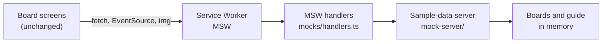

# The browser demo

The browser demo is the board running on a static site, with no `agboard serve` behind it. It is published with this documentation site at [`/agent-board/demo/`](https://fooqoo.github.io/agent-board/demo/). The screens are the product's own; only the server is replaced, by the sample-data server running in the page.

What a visitor sees is the [first-run guide](../../guide/quickstart.md#before-you-start-the-first-run-guide) followed by the ordinary board. This page explains how that is built, how to build it, and how to check it before it is published.

## How it works



`app/entry/board.tsx` checks `import.meta.env.MODE`. In the `demo` mode, and in the sample-data mode, it first loads `web/src/app/development/mocks/start.ts`, which starts the Service Worker, and only then renders the board. Every other build skips that import, so the product build contains none of the mock code, and `web/test/build-contract.test.ts` checks that.

### The sample-data server

`web/src/app/development/mock-server/` answers `/api/*` the way `agboard serve` does, from boards held in memory. It uses no Node API and no transport of its own. MSW carries requests to it, and the same handlers serve every place that needs the sample data:

- the demo and the [sample-data mode](../getting-started/setup.md#development) (`pnpm --dir web dev --mode mock`), through a Service Worker in the page
- the unit tests, through `setupServer()`, and Storybook, through the browser worker, as described in [Mock handlers](../getting-started/setup.md#mock-handlers)

The boards are made fresh from `web/test/fixtures/board.json` each time a server starts, which is each page load. The page reads that fixture through the `virtual:agboard-mock-seed` module, which `web/mock-browser.ts` builds from the file in both modes. The demo passes `demo: true`, so it has a single project named `demo`, and its board starts with one open question, on card #12. The sample-data mode keeps three projects and three open questions for development and tests.

Besides reads, the server handles the writes a visitor can make:

- creating, editing, and moving cards, and reordering them within a lane
- answering a question
- listing versions, setting the current version, planning a task, and planning an epic, with and without `dryRun` (`versions.ts`; the routes `versions`, `versions/current`, `tasks/{id}/planned-version`, and `epics/{id}/planned-version`)
- checking an acceptance condition, followed by the automatic Done that the server's watcher performs for an AI task whose conditions are all met (`completion.ts`)

Each change is reported to subscribers in the shape of the SSE `changed` event, so the screens update as they would against a real server.

### The Service Worker

`web/src/app/development/mocks/handlers.ts` turns the sample-data server into MSW handlers: `http.all` handlers for `/api/*` and `/__mock/*`, and one `sse('/api/events')` handler.

- A request becomes a `MockRequest` and is answered by `MockServer.handle()`. A request body is read as text; for a multipart form, only its `metadata` field is read.
- The `/api/events` handler sends `ready` and then delivers each change after the answer to the write that caused it, matching the order seen over the network. It stops listening when the page closes the stream.
- Pictures need no rewrite: the Service Worker answers `` requests for an attachment or the sample picture under `/__mock/` too.
- The page's query (`location.search`) is passed to the server as page parameters, such as `?empty=1` or `?disconnect=1`.

`web/src/app/development/mocks/browser.ts` starts the worker before the first render, so the board's first request already has an answer:

- The script is MSW's own `mockServiceWorker.js`. `web/mock-browser.ts` serves it from the installed `msw` package in the dev server and emits it into the demo build, so it sits in the demo's own folder, `/agent-board/demo/mockServiceWorker.js`, and no copy is committed. The page registers it with `import.meta.env.BASE_URL`, so its scope is the folder of the page and GitHub Pages needs no extra header.
- The worker intercepts the page's requests to `/api/`, although that path is outside the scope: the scope limits which pages the worker controls, not which request URLs it sees. A documentation page outside `/agent-board/demo/` is not controlled, so the worker does not touch the rest of the site.
- A page loaded by a hard reload (Shift+Reload) is not controlled until the next load. If the page is not controlled after the worker starts, it reloads once (a flag in `sessionStorage` prevents a loop).
- A browser with no Service Worker support, such as a Firefox private window or a page on a non-secure origin, or one that cannot transfer a `ReadableStream` to the worker (Safari before 27, where MSW would buffer the endless event stream), shows a short notice in English or Japanese instead of the board. The demo has no second transport. A worker that fails to register, for example because the browser blocks the script, shows a second notice ("the demo could not start"), and the board stays unrendered.

### The first-run guide

The guide runs in the page, as it does against `agboard serve`: its sample request, the plan, the steps, and the question are local to the front end (`web/src/app/onboarding/`). The sample-data server (`mock-server/guide.ts`) answers only the two routes the real server has: `GET /api/onboarding` and `POST /api/onboarding/seen`. It writes no card to the demo's board.

The seen state lives only in memory. A new page is a new server, so the guide starts again on every page load, and **Skip** or **Finish and get started** closes it for that page only. Its user-facing steps are described in the [quickstart](../../guide/quickstart.md#before-you-start-the-first-run-guide).

### Language

The demo starts in the language of the visitor's browser. `mocks/start.ts` reads the first entry of `navigator.languages` through `mocks/locale.ts`: Japanese when it starts with `ja`, English otherwise. It applies that language before the first screen is drawn, so the screens and the first-run guide start in it, and passes it to the sample-data server as `locale`.

The sample boards come from the English fixture. For a Japanese start, `mock-server/sampleJa.ts` puts Japanese words in their place: card titles and descriptions, history entries, waiting reasons, choices, acceptance conditions, the epic name, and the long Markdown description. The cards keep their IDs, lanes, and states. The sample-data mode (`pnpm --dir web dev --mode mock`) passes no `locale` and stays in English.

The demo ignores any language an earlier visit left in the browser. A language chosen in the settings applies at once and lasts until the page is reloaded; a reload follows the browser's language again. The sample data keeps the language it started with.

### Hidden features

A static site has no computer and no `agboard serve` to reach, so the demo hides the features that need one:

| Feature | Where it is hidden | Why |
| --- | --- | --- |
| Project Docs | `BoardWorkspace.tsx` passes no `onDocs`, so the header has no **Docs** button | Docs open files and folders on the computer. |
| Remote connection | `BoardSettings.tsx` leaves out the connection row and dialog | A phone connects to an `agboard serve`. |
| Attachments | `EditorBody.tsx` and `AskAiDialog.tsx` offer no images panel and ignore pasted or dropped images | Nothing is saved, so there is nowhere to keep them. |
| Saved language and theme | `app/entry/board.tsx` and `BoardSettings.tsx` skip `/api/preferences` | There is no server to keep them. The theme stays in the browser, as in the sample-data mode; the language follows the browser on each page load. |

The page also has a fixed token and an empty build ID, so it never reloads for a newer build. Nothing is saved: a reload starts again from the sample data.

## Build it

The commands and the base-path option are in [Set up and run: Demo build](../getting-started/setup.md#demo-build). In short, `pnpm --dir web build:demo` writes `web/dist-demo/` for the base `/agent-board/demo/`, and `AGPJ_DEMO_BASE` changes the base.

`.github/workflows/docs.yml` builds the documentation site, builds the demo, and copies `web/dist-demo/` into `docs/.vitepress/dist/demo/`. VitePress empties its output folder when it builds, so the copy comes after the site build. See [Documentation and images](../docs-and-images.md#documentation-site) for the rest of the site workflow.

## Check it locally

For a quick look, `pnpm --dir web preview:demo` serves the demo alone, as described in [Demo build](../getting-started/setup.md#demo-build).

To check it the way it is published, build the site with the demo inside it and run the demo suite:

```sh
pnpm --dir docs build
pnpm --dir web build:demo
rm -rf docs/.vitepress/dist/demo
cp -R web/dist-demo docs/.vitepress/dist/demo
pnpm --dir e2e test:demo
```

The suite (`e2e/playwright.demo.config.ts` and `e2e/demo/`) serves `docs/.vitepress/dist/` with `vitepress preview` on port 8446, or on `AGPJ_DEMO_E2E_PORT`, and opens `/agent-board/demo/` in Chromium. Like the documentation site suite, it needs no Rust build and no `AGPJ_HOME`, because the board lives in the page. Playwright allows Service Workers by default, and the demo does not render its board until the worker controls the page, so the tests need no extra wait; keep `serviceWorkers` out of the Playwright config. It checks that:

- the guide starts on page load and runs to the end, including sending its sample request in Ask AI and answering its question, at desktop width and at phone width
- after the guide, a card can be dragged to another lane
- answering a waiting card and checking its last acceptance conditions moves it to Done automatically
- the Docs button and the remote connection are absent, and a reload starts again from the sample data
- in a `ja-JP` browser, the screens, the guide, and the sample cards start in Japanese
- a language chosen in the settings lasts until the page is reloaded, and a reload starts in the browser's language again
- on the documentation pages with flowcharts, in English and Japanese and at phone and desktop width, no Mermaid label is cut off by its box (`e2e/demo/docs-mermaid.spec.ts`)

The English tests set their browser locale to `en-US` and the Japanese ones to `ja-JP`, with `test.use({ locale })`.

The Pages workflow runs the same suite after the demo is copied and before anything is uploaded, on pull requests too, so a broken demo is never published.

When you change the demo's screens, also look at them at desktop and phone widths, in light and dark themes, as described in [Conventions](../getting-started/pull-request.md#conventions).
