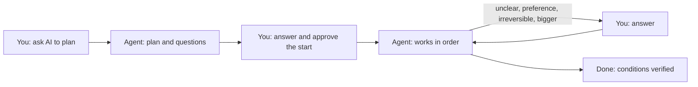
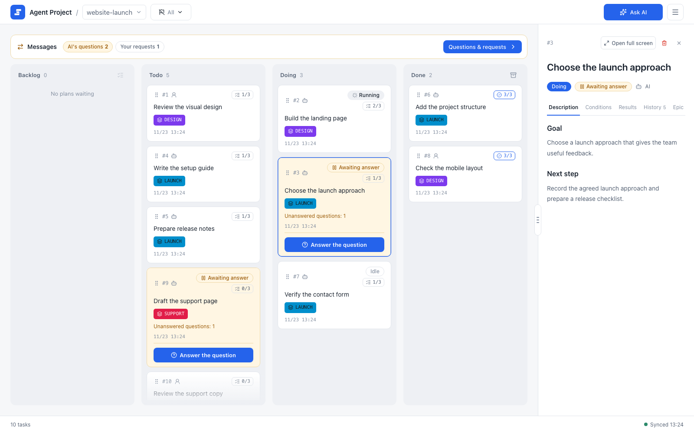

# Introduction

<video class="demo-video" :src="withBase('/videos/demo.mp4')" :poster="withBase('/videos/demo.jpg')" autoplay muted loop playsinline></video>

Agent Project lets big work move on without you driving it. You ask AI to plan the work with **Ask AI**, approve the start, and answer the decisions it raises along the way. You then receive results that were checked against the acceptance conditions: when every condition of a task is verified, the task moves to Done on its own.

Want to see it for yourself? [Try the demo](https://fooqoo.github.io/agent-project/demo/) in your browser, with nothing to install. It opens the first-run guide on sample data, in Japanese when your browser prefers Japanese and in English otherwise. Reloading the page starts it over.

## The problem: a long job needs someone to drive it

You can hand a big piece of work to an AI agent, but it rarely runs to the end on its own. It wanders, stops, or calls the work done too early, so someone has to turn the request into a plan, notice when the agent is stuck or off course, catch the question that scrolled past in the chat, explain the work again after a new session starts, and check at the end whether it is really done. The agent works, and you keep driving.

Agent Project is built to cut that driving down. It does not run the agent. It gives the agent the project management it lacks, so that you can ask for the work, answer when you are asked, and stay away the rest of the time. It is made for people building a product alone with Codex or Claude Code.

## Agent Project: project management for agents

An agent such as Claude Code or Codex already has what it needs to act: tools, context, and a loop. What it lacks is a model of the project around the work. Agent Project is that layer, shared between your agent and you: the agent plans and reports, and you answer. It keeps four things in one place:

- **A plan in order.** The goal is broken into epics and tasks. Epics group the work and set its order, and tasks are the pieces that can be reviewed on their own. The agent reads the order to know what to do next.
- **A definition of done.** Each task says up front, in its acceptance conditions, what has to be true for it to be finished, and the agent checks them before it calls the task done.
- **Questions the agent must stop for.** When a decision is yours, the agent asks with choices and waits, instead of deciding alone. The question and your answer are recorded once, whichever monitor you answer in.
- **A record of what was done and decided.** Every move, question, answer, and check is kept as history with its reason, and results record the outcome, so a new session or a different agent can continue from where the last one stopped, and you can read back what happened.

Everything is stored as plain files on your machine, and you and the agent read and write the same files. See [The work model](./work-model) for the elements, the states, and what Agent Project guarantees.

## How delegation works

You do not write the plan. You ask, and the agent does the planning on the board.

1. **Ask AI to plan.** Ask for what you want in your own words, with **Ask AI** on the board or in the agent's chat.
2. **It plans.** The agent puts a plan on the board: an epic, and tasks in work order, each with acceptance conditions. It also asks the questions it cannot settle itself.
3. **You approve the start.** You answer the questions, and the plan goes to Todo. A plan you asked for on its own waits in the Backlog until you send it; a request to carry out the work goes straight to Todo. A task does not start while a question linked to it is open.
4. **You answer on the way.** The agent works through the tasks in order, records what it does, and decides everything else itself. It calls you in four cases: your intent is unclear, your preference decides it, an action cannot be undone, or the work grows beyond what you asked.
5. **You receive the result.** When the agent has verified every acceptance condition of a task and nothing is waiting on you, the task moves to Done by itself, and what was done and decided stays in its history and results.

[Quickstart](./quickstart) takes you through this once, and [Working with agents](./delegate/agents) describes it in full.

### Trying an idea before you commit to it

Suppose you're considering combining two signup screens. After talking it through with Claude, ask your agent to make a clickable mockup with the existing fields and attach screenshots of both layouts at phone width. Those are the acceptance conditions for this task.

Open the mockup. If the longer form pushes the submit button out of sight, you might keep the two screens and try removing an optional field next. The comparison gives you enough to make that call before spending time on a full implementation.

## Watching and answering

The board is one monitor for the work. A monitor is not watch-only: your phone, the chat, and the CLI show the same work, take the same answers, and let you step in. Wherever you look from, there are two ways to take part.

- **Answer when asked (human in the loop).** When the agent stops for a decision, you answer on the board, on your phone, in the chat, or with the CLI. The answer is recorded once, and the agent resumes. See [Decisions](./delegate/decisions).
- **Watch and step in (human on the loop).** The agent keeps working while you look. You move a card back, check an acceptance condition, or rewrite a plan, and the agent follows the change the next time it reads the board. See [The board](./watch/board).

{.screenshot}

The board shows Todo, Doing, and Done. Here a task in Doing is waiting for your answer, and every task shows how many of its acceptance conditions are done. On the go, the [remote access](./watch/remote-access) shows the same work on your phone. The agent's own monitor is the chat, and the `agpj` command is the one the agent and your scripts use.

## Where to start

New here? Read the first four pages in order.

1. [Install and start](./getting-started): install `agpj`, set up your agent, and open the board.
2. [Quickstart](./quickstart): delegate your first piece of work and watch it reach Done.
3. [The work model](./work-model): the few ideas that explain everything else.
4. [Working with agents](./delegate/agents): how the agent plans, asks, and finishes.

## Find what you need

| I want to… | Read |
| --- | --- |
| Hand a piece of work to an agent | [Quickstart](./quickstart) and [Working with agents](./delegate/agents) |
| Answer a question from an agent | [Decisions](./delegate/decisions) |
| Add, move, and review tasks | [The board](./watch/board) |
| Group tasks and see what to do next | [Epics and progress](./watch/epics) |
| Write a task and attach images | [Editing and image attachments](./watch/editing) |
| Read and edit the project's Markdown documents | [Project docs](./watch/docs) |
| Check on the board from my phone | [Remote access](./watch/remote-access) |
| Look up a command | [CLI reference](./reference/cli) |
| Edit `TASK.md` or `EPIC.md` by hand | [Markdown file format](./reference/file-format) |
| Know where files live, back them up | [Data and backups](./operations/data) |
| Fix something that does not work | [Troubleshooting](./operations/troubleshooting) |

For what the Agent Project plugin installs in Claude Code and Codex, see the [plugin guide](https://github.com/FooQoo/agent-project/blob/main/plugins/agent-project/README.md). If you want to change Agent Project itself, read the [developer guide](../dev/).
