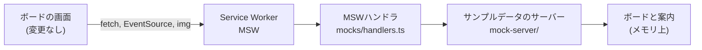

# ブラウザのデモ

ブラウザのデモは、`agboard serve`を置かずに静的サイトの上でボードを動かすものです。このドキュメントサイトと一緒に[`/agent-board/demo/`](https://fooqoo.github.io/agent-board/demo/)で公開しています。画面は製品と同じもので、サーバーだけがページ内で動くサンプルデータのサーバーに置き換わっています。

訪れた人には、まず[初回の案内](../../guide/quickstart.md#before-you-start-the-first-run-guide)が表示され、そのあと通常のボードを操作できます。このページでは、その仕組み、ビルドの方法、公開前に確かめる方法を説明します。

## 仕組み



`app/entry/board.tsx`は`import.meta.env.MODE`を見ます。`demo`モードとサンプルデータモードでは、まず`web/src/app/development/mocks/start.ts`を読み込んでService Workerを起動し、そのあとでボードを描画します。ほかのビルドはこの読み込みを通らないため、製品のビルドにモックのコードは含まれません。`web/test/build-contract.test.ts`がそれを確かめます。

### サンプルデータのサーバー

`web/src/app/development/mock-server/`は、メモリ上のボードから`agboard serve`と同じように`/api/*`に応答します。NodeのAPIも独自の通信路も使いません。リクエストはMSWが運び、サンプルデータが必要なすべての場所で同じハンドラを使います。

- デモと[サンプルデータモード](../getting-started/setup.md#開発)（`pnpm --dir web dev --mode mock`）は、ページの中のService Workerを通します。
- 単体テストは`setupServer()`、Storybookはブラウザ用のワーカーを通します。[モックハンドラ](../getting-started/setup.md#モックハンドラ)を参照してください。

ボードは、サーバーが起動するたび、つまりページを読み込むたびに`web/test/fixtures/board.json`から作り直します。ページは、このフィクスチャを`virtual:agboard-mock-seed`モジュールとして読み込みます。`web/mock-browser.ts`が、どちらのモードでもこのファイルからモジュールを作ります。デモは`demo: true`を渡すので、プロジェクトは`demo`という名前の1つだけで、ボードの未回答の質問はカード#12の1件から始まります。サンプルデータモードは、開発とテストのためにプロジェクト3つと未回答の質問3件を保ちます。

読み取りに加えて、訪れた人ができる書き込みにも応答します。

- カードの作成、編集、レーン間の移動、レーン内の並べ替え
- 質問への回答
- 完了条件のチェックと、そのあとの自動Done。すべての条件を満たしたAIのタスクを、サーバーの監視と同じようにDoneに移します（`completion.ts`）

変更はそれぞれSSEの`changed`イベントと同じ形で購読者に届くので、画面は本物のサーバーを相手にしたときと同じように更新されます。

### Service Worker

`web/src/app/development/mocks/handlers.ts`は、サンプルデータのサーバーをMSWのハンドラに変えます。`/api/*`と`/__mock/*`向けの`http.all`ハンドラと、`sse('/api/events')`ハンドラが1つです。

- リクエストは`MockRequest`になり、`MockServer.handle()`が応答します。リクエストの本文はテキストとして読みます。マルチパートのフォームは`metadata`フィールドだけを読みます。
- `/api/events`のハンドラは`ready`を送り、そのあとの変更は、それを起こした書き込みへの応答のあとに届けます。ネットワーク越しと同じ順序です。ページがストリームを閉じると、サーバーの購読をやめます。
- 画像の書き換えは要りません。添付画像や`/__mock/`のサンプル画像への``のリクエストも、Service Workerが応答します。
- ページのクエリ（`location.search`）は、`?empty=1`や`?disconnect=1`のようなページのパラメーターとしてサーバーに渡します。

`web/src/app/development/mocks/browser.ts`は、最初の描画の前にワーカーを起動します。ボードの最初のリクエストにも応答できるようにするためです。

- スクリプトはMSW自身の`mockServiceWorker.js`です。`web/mock-browser.ts`が、インストール済みの`msw`パッケージから、開発サーバーでは配信し、デモのビルドでは書き出します。そのため、デモ自身のフォルダ（`/agent-board/demo/mockServiceWorker.js`）に置かれ、コピーはコミットしません。ページは`import.meta.env.BASE_URL`でこれを登録するので、スコープはページのフォルダになり、GitHub Pagesに追加のヘッダーは要りません。
- `/api/`はスコープの外のパスですが、ワーカーはページからのリクエストを横取りできます。スコープが決めるのは、ワーカーが制御するページであって、ワーカーが目にするリクエストのURLではないからです。`/agent-board/demo/`の外にあるドキュメントのページは制御されないので、サイトのほかの部分にワーカーは影響しません。
- ハードリロード（Shift+リロード）で読み込んだページは、次の読み込みまでワーカーに制御されません。ワーカーの起動後もページが制御されていなければ、1回だけ再読み込みします（`sessionStorage`のフラグでループを防ぎます）。
- Service Workerに対応しないブラウザ（Firefoxのプライベートウィンドウや、安全でないオリジンのページなど）では、ボードの代わりに短いお知らせを英語または日本語で表示します。デモに2つ目の通信路はありません。

### 初回の案内

案内は、`agboard serve`に対してと同じく、ページの中で動きます。サンプルの依頼、計画、その手順、質問はフロントエンド（`web/src/app/onboarding/`）の中だけにあります。サンプルデータのサーバー（`mock-server/guide.ts`）が答えるのは、本物のサーバーにもある2つのルート、`GET /api/onboarding`と`POST /api/onboarding/seen`だけです。デモのボードにカードを書き込むことはありません。

「見た」という状態はメモリにしかありません。新しいページは新しいサーバーなので、ページを開くたびに案内が始まり、**スキップ**や**完了して始める**はそのページでだけ案内を閉じます。画面での手順は[クイックスタート](../../guide/quickstart.md#before-you-start-the-first-run-guide)を参照してください。

### 言語

デモは、訪れた人のブラウザの言語で始まります。`mocks/start.ts`が`mocks/locale.ts`を通して`navigator.languages`の先頭を読み、`ja`で始まれば日本語、それ以外は英語にします。最初の画面を描く前にその言語を適用するので、画面と初回の案内はその言語で始まります。同じ言語を`locale`としてサンプルデータのサーバーにも渡します。

サンプルのボードは英語のフィクスチャから作ります。日本語で始めるときは、`mock-server/sampleJa.ts`が日本語の文に置き換えます。対象はカードのタイトルと説明、履歴、回答待ちの理由、選択肢、完了条件、エピック名、長いMarkdownの説明です。カードのID、レーン、状態は変わりません。サンプルデータモード（`pnpm --dir web dev --mode mock`）は`locale`を渡さないので、英語のままです。

以前の訪問でブラウザに残った言語は使いません。設定で言語を選ぶとすぐに切り替わり、ページを再読み込みするまでその言語のままです。再読み込みすると、またブラウザの言語に従います。サンプルデータは、始めたときの言語のままです。

### 隠している機能

静的サイトには手元のコンピューターも`agboard serve`もないので、それらが必要な機能はデモでは隠しています。

| 機能 | 隠している場所 | 理由 |
| --- | --- | --- |
| プロジェクトのDocs | `BoardWorkspace.tsx`が`onDocs`を渡さないので、ヘッダーに**Docs**ボタンが出ない | Docsはコンピューター上のファイルやフォルダーを開くため。 |
| リモート接続 | `BoardSettings.tsx`が接続の行とダイアログを出さない | スマホは`agboard serve`に接続するため。 |
| 添付 | `EditorBody.tsx`と`AskAiDialog.tsx`が画像の欄を出さず、貼り付けやドロップした画像を無視する | 何も保存しないので、置き場所がないため。 |
| 言語とテーマの保存 | `app/entry/board.tsx`と`BoardSettings.tsx`が`/api/preferences`を使わない | 保存するサーバーがないため。テーマはサンプルデータモードと同じくブラウザの中に残し、言語はページを開くたびにブラウザに従う。 |

ページのトークンは固定で、ビルドIDは空です。そのため新しいビルドを理由に再読み込みすることはありません。何も保存しないので、再読み込みするとサンプルデータから始まります。

## ビルドする

コマンドとベースパスの指定は、[開発環境のセットアップのデモビルド](../getting-started/setup.md#demo-build)にあります。要点は、`pnpm --dir web build:demo`がベース`/agent-board/demo/`向けに`web/dist-demo/`を書き出し、`AGBOARD_DEMO_BASE`でベースを変えられることです。

`.github/workflows/docs.yml`は、ドキュメントサイトをビルドし、デモをビルドし、`web/dist-demo/`を`docs/.vitepress/dist/demo/`にコピーします。VitePressはビルドのたびに出力フォルダーを空にするので、コピーはサイトのビルドのあとです。サイトのワークフローのそのほかの部分は[ドキュメントと画像](../docs-and-images.md#ドキュメントサイト)を参照してください。

## 手元で確かめる

さっと見るだけなら、[デモビルド](../getting-started/setup.md#demo-build)にあるとおり`pnpm --dir web preview:demo`でデモだけを配信できます。

公開されるときと同じ形で確かめるには、デモを含めたサイトをビルドしてから、デモのスイートを実行します。

```sh
pnpm --dir docs build
pnpm --dir web build:demo
rm -rf docs/.vitepress/dist/demo
cp -R web/dist-demo docs/.vitepress/dist/demo
pnpm --dir e2e test:demo
```

このスイート（`e2e/playwright.demo.config.ts`と`e2e/demo/`）は、`docs/.vitepress/dist/`を`vitepress preview`でポート8446（または`AGBOARD_DEMO_E2E_PORT`）から配信し、Chromiumで`/agent-board/demo/`を開きます。ドキュメントサイトのスイートと同じく、ボードがページの中にあるので、Rustのビルドも`AGBOARD_HOME`も要りません。PlaywrightはService Workerを既定で許可し、デモはワーカーがページを制御するまでボードを描画しないので、テストに追加の待機は要りません。Playwrightの設定に`serviceWorkers`を入れないでください。確かめる内容は次のとおりです。

- ページを開くと案内が始まり、「AI に依頼」でのサンプルの依頼の送信と質問への回答を含めて、PC幅でもスマホ幅でも最後まで進む
- 案内のあと、カードを別のレーンにドラッグで移動できる
- 回答待ちのカードに回答し、残りの完了条件をチェックすると、自動でDoneに移る
- Docsボタンとリモート接続がなく、再読み込みするとサンプルデータから始まる
- `ja-JP`のブラウザでは、画面、案内、サンプルのカードが日本語で始まる
- 設定で選んだ言語は再読み込みまで続き、再読み込みするとブラウザの言語で始まる
- フローチャートのあるドキュメントのページで、英語と日本語、スマホ幅とPC幅のどれでも、Mermaidのラベルが枠で切れない（`e2e/demo/docs-mermaid.spec.ts`）

英語のテストはブラウザのロケールを`en-US`に、日本語のテストは`ja-JP`に、`test.use({ locale })`で設定しています。

Pagesのワークフローは、デモをコピーしたあと、何かをアップロードする前に、プルリクエストでも同じスイートを実行します。そのため、壊れたデモが公開されることはありません。

デモの画面を変えたときは、[規約](../getting-started/pull-request.md#規約)にあるとおり、デスクトップとスマホの幅、ライトとダークのテーマでも見てください。
