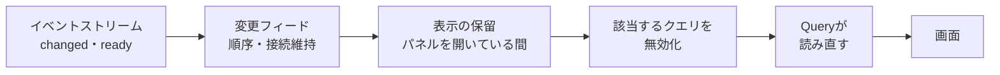

# サーバーと画面

`agpj serve`は、JSON APIと更新通知を提供し、バイナリに埋め込んだReactアプリでカンバンを表示します。このページでは、リクエストの処理、画面の構成、エラー発生時の動作を説明します。エンドポイントは[Web API](../reference/web-api.md)にあります。

## serveの起動と停止

データ領域ごとにサーバーは一つまでです。動き方は二通りあり、`serve.json`の`mode`に記録します。

- **自動**　サーバーがないと動かないコマンドが、裏でサーバーを起動します。対象は`wait --after`、`wait --until task`、`--no-wait`を付けない`message ask`、未回答の質問を待つ`message wait`です。エージェントのHookも、待たずに起動します。使われなくなると、サーバーは自分で止まります。
- **手動**　人が`agpj serve`（前面）か`agpj serve -d`（裏）で起動します。Ctrl+Cか`agpj stop`まで動き続けます。

ほかのコマンドはファイルだけで動き、サーバーを起動しません。

### 起動

- `serve`は`127.0.0.1`だけで待ち受け、プロジェクトが0件でも動きます。空のデータ領域には`workspace.json`を作ることがあります。
- データ領域ごとにサーバーが一つだけ動くよう、`lifecycle.lock`（標準の`try_lock`）を起動から終了まで保持します。ファイルがあるだけでサーバーが動いているとは判断しません。ロックはプロセスの終了で外れます。自動のサーバーは、終了処理中のサーバーがロックを外すのを最大10秒待ちます。
- 起動時に`serve.json`があり、そのポートの`GET /api/health`が同じ`pid`を返すなら、`serve`は`already_serving`で終了します。そうでなければ古いファイルとして上書きします。動いているサーバーが自動なら、理由には動かし続けるための`agpj serve -d`を示します。
- `serve -d`は先に同じ確認をします。動いているサーバーが自動で、それと食い違う`--port`や`--monitor`の指定がなければ、そのサーバーにSIGUSR1を送ります。同じプロセスが`mode: "manual"`を記録し、使われていない時間を数えるのをやめます。接続はどれも切れません。それ以外の場合、ターミナルで人が実行していれば、動いているサーバーを`stop`と同じ手順で止めて起動し直すかどうかを尋ね、`--json`を付けたときやターミナルの外では`already_serving`で終了します。
- `serve`は待ち受けを始めた後に`serve.json`（`pid`・`port`・`started_at`・`mode`、自動のサーバーでは`idleTimeoutSeconds`も）を書きます。SIGINTかSIGTERMを受けると、自分のpidが書かれている場合だけ`serve.json`を消します。

### コマンドがサーバーを起動する手順

1. `serve.json`を読みます。そのサーバーがヘルスチェックに応えれば、それを使います。
2. `serve.json`のpidが生きていて`lifecycle.lock`を持っているのに応えないときは、起動中か終了中の場合に備えて最大10秒待ち、そのpidを示した`board_unavailable`で失敗します。二つ目のサーバーは起動しません。OSやサンドボックスが接続を拒んだときは`local_network_denied`です。
3. それ以外なら`autostart.lock`を取ります。ほかのコマンドが起動中なら最大40秒待ち、もう一度確かめます。
4. `agpj --json serve --auto`を新しいセッション（`setsid`）として起動します。作業ディレクトリはデータ領域、標準出力と標準エラーは`serve.log`（起動のたびに空にし、権限は0600）です。子プロセスは開いたままの`autostart.lock`を受け継ぎ、準備ができてから外すので、その間にほかのコマンドが二つ目を起動することはありません。
5. `serve.log`に起動の行が出るまで最大30秒待ち、標準エラーに1行出して続けます。標準出力はコマンド本来の出力のままです。

```text
Started the Agent Project server at http://127.0.0.1:7420/ in the background. It stops by itself after 30 minutes without use.
```

`serve.json`を読んだ後に接続が失敗したとき（その間にサーバーが止まったときなど）は、もう一度だけ起動します。Hookは待たずに起動します。確かめるのは`serve.json`のpidが生きているかと`autostart.lock`が空いているかだけで、`agpj stop`の後は起動しません（後述）。失敗は`serve.log`に残ります。

`AGPJ_AUTOSTART=0`にすると、これらはすべて止まります。コマンドはこれまでどおり`board_unavailable`を返し、Hookは何も起動しません。ライブラリが自分でサーバーを起動することはなく、起動するのは`agpj`のコマンドラインだけです。

### カンバンを開く {#opening-the-board}

自動のサーバーは、起動のきっかけになったプロジェクトのカンバンを一度だけ開きます。利用者から見た決まりは[CLIリファレンス](../../guide/reference/cli.md#open-the-board-in-the-browser)にあります。

- サーバーを起動するコマンドは、隠しオプション`serve --auto --open-board=<projectId>`でプロジェクトIDを渡します。待つコマンドは待っているプロジェクト、`message ask`と`message wait`は質問のプロジェクト、Hookは出力した進行表のプロジェクトを渡します。`agpj open`は自分でページを開くので、何も渡しません。
- サーバーの準備ができて`autostart.lock`を外した後、スレッドが3秒待ちます（試験では`AGPJ_OPEN_GRACE_MS`で変えられ、上限は60,000ミリ秒）。起動してからカンバンのページが一度もつながっていなければ、`http://127.0.0.1:<port>/?project=<projectId>`を開きます。つながってから閉じたタブも、つながり直すかもしれないので数に入れます。
- カンバンのページとは、`X-Agpj-Wait`ヘッダーのない`GET /api/events`のストリームです。待つコマンドはこのヘッダーを付けるので、起動の直後に開く自分のストリームがタブと取り違えられることはありません。スマホのページがngrokの入口を通して開くのは、sessionの背後にある同じストリームで、同じように数えます。
- ブラウザーを開けるかどうかは`src/interact/browser.rs`が次の順で決めます。`AGPJ_OPEN_BROWSER=0`なら開きません。`AGPJ_BROWSER_OPENER`があれば、そのプログラムをシステムのものの代わりに使います。`SSH_CONNECTION`か`SSH_TTY`があれば開きません。macOSとWindows以外では、`DISPLAY`も`WAYLAND_DISPLAY`もなければ開きません。それ以外なら`open`（macOS）、`explorer`（Windows）、`xdg-open`を、アドレスだけを引数にしてシェルを通さずに起動し、終わるのを待ちません。
- 結果は`serve.log`に1行残ります。`Opened … in the browser.`、理由つきの`Did not open … in the browser.`、プログラムを起動できなかったときの`Could not open …`のどれかです。
- サーバーの起動と同じく、ブラウザーを開くのは`agpj`のコマンドラインだけで、試験に組み込んだライブラリは開きません。試験は`AGPJ_OPEN_BROWSER=0`を設定し、開く処理の試験は`AGPJ_BROWSER_OPENER`をアドレスを記録するスクリプトに向けます。

### ポート

- 手動のサーバーは`--port`（既定は7420）だけで待ち受けます。使われているポートは`port_in_use`で、理由には使っているものを示します。データ領域の違う別のAgent Projectのサーバー（pidつき）か、別のプログラムです。
- 自動のサーバーはまず7420を試します（`AGPJ_AUTOSTART_PORT`で変えられ、試験では0を使います）。使われていれば、OSが選んだポートで待ち受け、その理由を出します。例：`Port 7420 is used by another program, so this server uses port 52114.`
- OSやサンドボックスによる拒否（`EACCES`か`EPERM`）は`local_network_denied`です。そのほかの待ち受けの失敗は、OSのメッセージつきの`board_unavailable`です。

### 自動での停止

自動のサーバーは、次のどれかに当てはまる間は「使われている」とみなします。

- `GET /api/health`以外のリクエストが、使われない時間の上限内に届いた。
- イベントストリーム（`GET /api/events`）が開いている。ブラウザーのタブ、`wait`、答えを待つ質問がこれに当たります（待つコマンドは自分のストリームに`X-Agpj-Wait`ヘッダーを付けます。[カンバンを開く](#opening-the-board)を参照）。
- 携帯モニターの接続が、開始中・接続済み・再接続中・停止中のどれかである。
- ファイルの監視が、上限内にカンバンかDocsの変更を見つけた。ファイルを直接編集するエージェントのために、自動Doneが働くようサーバーを残します。

上限は30分で、`AGPJ_IDLE_TIMEOUT`で60〜86400秒に変えられます。確認は30秒ごとで、単調増加の時計を使います。上限の間使われなかったときは、まず`serve.json`を消します（新しいコマンドがこのサーバーにつながず、新しく起動するためです）。続けて新しいリクエストに`503 board_unavailable`を返し、モニターの接続を終え、`lifecycle.lock`を外し、`serve.log`に`Stopped after 30 minutes without use.`と書きます。

### stop

`stop`は、どちらの動き方でも`serve.json`の`pid`にSIGTERMを送ります。ポートが応答しなくなり、さらに`lifecycle.lock`を取れるようになってから戻るので、直後に起動した`serve`が`database_busy`で失敗することはありません。10秒たってもサーバーの終了処理が終わらなければ、`stop`は失敗します。

`stop`はデータ領域に`autostart.paused`も残し、Hookがすぐにまた起動しないようにします。待つコマンド、`serve`、`serve -d`がこれを消して、サーバーを起動します。

## リクエストの処理

リクエストは、次の順序で処理します。

1. **Hostの確認。** `127.0.0.1:<port>`か`localhost:<port>`だけを受け付けます。
2. **書き込みの保護**（書き込みのみ）。`Origin`・`Sec-Fetch-Site: same-origin`・`X-Agpj-Token`がすべて一致しなければなりません（[セキュリティモデル](./security.md#ブラウザからの書き込み)を参照）。これらの検証は対象データを検索する**前**に行うため、不正なリクエストからデータの存在を探ることもできません。
3. **操作。** 読み込みはメモリ上の索引から返します。書き込みはプロジェクトの書き込みロックを取って最新のファイルを読み、`task.json`と`TASK.md`を一組で確定し、何かが変わったときだけ再読み込みと通知を起こします（[保存と復旧](./saving-and-recovery.md#タスクの保存)を参照）。

書き込みの対象は、常にURLのProjectIdです。Webの`actor`は常に`human`で、要求から受け取ることはありません。`/api/board`のような対象のない経路、互換の別名、プロジェクトを作成・名前変更・削除するHTTP APIはありません。

[プロジェクトのドキュメント](../reference/web-api.md#プロジェクトのドキュメント)のルートは、手順3の例外です。索引とプロジェクトの書き込みロックを使わず、プロジェクトの`docs/`のファイルを直接読みます。書き込みはしません。開くルートは、プログラムの起動がディスクに触れることがあるため、ブロッキング用のスレッドで動きます。

JSONとHTMLの応答は`no-store`です。スクリプトとスタイルシートは内容から名前を付け、`Cache-Control: public, max-age=31536000, immutable`で送ります。ブラウザがgzipを受け付ける場合はgzipで圧縮して送ります。新しいビルドではHTMLが読み込む名前が変わるため、再読み込みすれば常に最新の画面になります。HTMLの応答には`Referrer-Policy: no-referrer`と`Content-Security-Policy`を付けます。スクリプトと接続は自分自身だけ、スタイルは自分自身と`'unsafe-inline'`（エディターが実行時に`<style>`を挿入するため）、画像は自分自身・`data:`・`http`・`https`です。

## Web画面の作り

- `web/`はVite・TypeScript・Reactのアプリです。nuqsが選択対象のプロジェクトをURLで管理し（`useQueryState('project', parseAsString)`）、`useBoard`がプロジェクトごとの取得・購読・読み込みを担い、一つの`useReducer`が適用中のプロジェクト・切り替え待ち・タスクの選択・ダイアログを連動させます。部品内の入力は`useState`です。ほかの状態管理やフォームのライブラリは足しません。
- 初回のプロジェクト選択はブラウザ履歴を置き換え、メニューからの選択は履歴に追加します。戻る・進むはnuqsのadapterに従います。History APIを直接使ったり、独自に`popstate`を処理したりはしません。
- 一つのアプリが二つの表示を受け持ちます。`useNarrowViewport`（`web/src/shared/lib/viewport/useNarrowViewport.ts`）が`matchMedia('(max-width: 767px)')`に従うので、幅を変えるとその場で画面が切り替わります。768px未満では、`App`は`BoardWorkspace`の代わりにスマホ幅の画面（`web/src/app/mobile/MobileBoard.tsx`）を描きます。この画面は必要になったときに読み込むので、カンバンの初回読み込みは変わりません。768px以上ではPC向けのカンバンを描きます。初回の案内はどちらの表示でも動きます。詳しくは[初回の案内](#初回の案内)を参照してください。利用者から見た画面は[カンバン](../../guide/watch/board.md#narrow-windows-and-phones)を参照してください。
- スマホ幅の画面（`web/src/pages/monitor/MonitorProject.tsx`の`MonitorScreen`）は、アプリが依存先を渡します。渡すのは、添付の読み取り先と完了条件の書き込み（`MonitorReadResolvers`）、言語とテーマの保存先（`PreferencesEndpoint`）、メッセージの読み取りと、回答・取り下げの書き込み（`MessagesApi`）、ヘッダーのプロジェクト切り替えです。Agent Projectのアプリはサーバー自身のルートと、ページの資格情報（トークン、ngrokの入口ではsessionのCSRFトークン）を渡します（`web/src/app/mobile/boardEnvironment.ts`）。2つ目のアプリはなく、旧モニター専用の入口とビルドは廃止しました。
- スマホ幅の画面は、一度に一つのレーンを表示します。`LaneTabs`と`MonitorLanes`は表示中のレーンを共有するので、タブのタップとカルーセルのスワイプは食い違いません。タッチを受けるのは表示中のレーンだけです（残る二つは`inert`）。表示中のレーンを先頭から下へ引っ張ると、カンバンを更新します。`usePullToRefresh`（`web/src/shared/lib/gesture/`）がコンテナ上のタッチイベントを見て、引っ張る一覧を`scroller`で探します。レーンとスマホのメッセージシートはどちらも、共有の`PullIndicator`（`web/src/shared/ui/pull/`）とともにこれを使い、シートも同じプロジェクトのデータを更新します。一覧が先頭にあり、最初のはっきりした動きが下向きで横より縦のときだけ始まります。カードは指にあわせて（半分の距離、最大80px）`PullIndicator`とともに動き、44pxを超えてはなすと`onRefresh`を呼びます。画面の`refreshing`が立っている間は、終わってからさらに600msの間、スピナーを表示します。スマホの画面に更新ボタンはありません。カードがスライドするのは、長押しで選ばれた後だけです（`SwipeableCard`）。ほかのカードの横方向の動きはカルーセルのものになります。カード自身は何も書き込みません。レーンのボタンはカンバンの移動ルートで、理由なし・`fromStatus`付きで、すぐにカードを移動します（拒否されたときは`TransientNotice`の通知を出します）。アーカイブのボタンはアーカイブの確認、完了レーンの端を越えた長い左スワイプ（`useLaneOverscroll`は`useSideSwipe`の上に作っています。完了が表示されているとき、選択中のカードやそのタイル、`data-lane-ignore`のコントロール以外から始まり、左への動きだけを自分のものにするので、右へのスワイプはレーンの切り替えのままです。完了のレーンは指に付いて`translate3d`で動き、カードのアーカイブのタイルを写した、読み上げ対象外の飾りの`BulkArchiveTile`が`--reveal`にあわせて大きくなります。はなすとレーンは元に戻り、72px以上左へ、はっきり横向きに動いてはなしたときに選択が始まります）か、完了の最後のカードの後ろの**まとめて選んでアーカイブ**ボタンでも選択が始まります。完了レーンの選択は`preselect`付きの`useLaneSelection`なので、完了のカードはすべて選ばれた状態で始まり、ドロワーは`action="archive"`の`BacklogSheet`です。画面が書き込むのは、ユーザーが**アーカイブ (N)**を選んだときだけです（`useArchiveSelected`、後述）。完了のカードがないとき、または書き込みが使えないときは、どちらも出ません。下部のバー（`PhoneNavBar`は`.phone-nav`の行で、設定のドロワーは`PhoneNav`が持ちます）には、カンバン・メッセージ・依頼・アーカイブ・設定が並びます。メッセージは`MessagesSurface`をシートで開き、未回答の質問の数（`countMessages(...).fromAi`、0なら非表示）を示します。依頼は画面の`onAsk`を呼び、アーカイブは`Surface`のシートの`ArchiveListSheet`を開きます（中身は`useArchiveSheet`が読むアーカイブで、`useArchivePages`を通して`GET …/archive`を1ページずつ読みます。一覧を開いたときに最新のページを、最後の行が描画範囲に入ったときに次のページを取得し、復元しても読み直しません。行の下の`ArchiveListFooter`が、読み込み中・失敗と再試行・末尾の状態を出します。閉じると読み込んだ行と復元済みの行の記憶を捨てます。書き込みが使えないときは選べません）。各行はレーンと同じカード（`.swipe-card`の中の`MonitorTask`で、下に戻り先のレーンとアーカイブした日付を出します。アーカイブ済みのタスクには詳細がないため、タップしても何も起きません）で、行を左へスワイプするとすぐに右側の復元のタイルが開き（`ArchiveSwipeRow`。メモ化した行で、常に選択済みとして`useCardGesture`の上に作っています。`ArchiveVirtualList`は、シートの本文（`Surface`が`bodyRef`で公開するスクロール要素）の表示範囲付近の行だけをDOMに置きます）、タイルがカンバンの復元ルート（`writes.restore`）を呼びます。復元した行はアーカイブを読み直さずにすぐ一覧から消え（失敗したときは行を残してエラーを出します）、Agent Projectは読み直します。設定は`kind="sheet"`の`SettingsDialog`を開きます。シートは`Surface`を使います。バーは画面の端から浮かせたドックで、下の余白を`max(10px, var(--safe-bottom))`で取るので、シェルには下の余白がありません。`PhoneNavBar`は、マウントされている間ルートに`data-phone-nav`を付け、これが`--phone-nav-height`の値を決めます（バーの固定サイズに下の余白を足したもので、`phone-nav.css`にあります。バーがなければ未設定で0pxです）。シートはすべてこの高さの上に立ちます。`.mobile-drawer`は`bottom`を画面の端に置いたまま、自身の下パディングをこの変数の分だけ取ります（`box-sizing: border-box`）。そのためシートの背景はバーの後ろまで続き、内容はバーの上で終わります。既定とキーボード対応の高さにはこの変数を足し、画面上端から高さを決める決定・オンボーディングのシートからは引きません。背景の暗幕は`backdrop-filter`を使わない単純な暗転なので、その後ろのヘッダーはぼけません。バーは、開いたシートとそのバックドロップより手前に出て（`.mobile-drawer`がマウントされている間は`z-index: 60`）、モーダルなRadixダイアログが外側から取り除く`pointer-events`を`auto`に保ちます。`Drawer`は、対象が`[data-phone-nav-bar]`の内側にある外側の操作を無視するので、バーのタップは項目自身のハンドラが動く前にシートを閉じません。各項目は、自分が開かないシートを閉じてから（`View.tsx`の`closeSheets`、設定のドロワーは`PhoneNav`）自分のシートを開き、カンバンはすべてを閉じます。設定が開くダイアログ（通知と常駐セッションのダイアログ）は画面の外にあるので、バーの各項目は`dismissSettingsSheets`（`shared/lib/sheets/dismissSheets.ts`）も呼び、`NotificationHost`と`ResidentHost`はこれを受けて自分で閉じます。ダイアログは背後のページを`aria-hidden`にするので、シートが開いている間、バーはアクセシビリティツリーにありません。スクリーンリーダーの利用者は、先にシートを閉じます。画面のキーボードが開いている間（`data-visual-keyboard`、`data-keyboard`、または`data-text-focus`）は、シートを開いているかどうかにかかわらず、`phone-nav.css`がバーに`display: none`を、`--phone-nav-height`に0pxを設定します。そのためページとすべてのシートは、バーのために空けていた余白を手放します（シートの下パディングは0になります）。キーボード対応のシートは、自分の`bottom: var(--keyboard-inset)`を保ちます。印が外れるとバーは戻ります。書き込みが使えるときは、画面がサーバーのルート経由で送り、`useLaneOverlay`が結果を次の読み取りまで画面に残します。使えないとき（デモやサンプルデータ）は、スワイプしても何も尋ねず、何も変えません。ユーザーから見た画面は[リモートアクセス](../../guide/watch/remote-access.md#レーンを切り替える)を参照してください。
- `watchStableHeight`（`web/src/shared/viewport/stableHeight.ts`。`web/src/app/entry/board.tsx`で開始）は、ソフトウェアキーボードが開く前のページの高さを、ルートの`--stable-vh`に保ちます。入力欄にフォーカスがある間のビューポートの縮みはキーボードとみなして無視し、それ以外の変化（回転、ウィンドウのサイズ変更、ブラウザのツールバー）には追従します。CSSは`svh`を代替にして`--stable-vh`を使うので、カンバンがキーボードの上の細い領域に押しつぶされません。保持した高さがビューポートより高く、しかも入力欄にフォーカスがある間は、ルートに`data-keyboard`が付きます。この印はフォーカスが変わるたびに確かめ直すので、入力欄からフォーカスが外れるとすぐに消えます。`web/src/shared/styles/ui.css`の1つの規則が、ルートに`data-keyboard`または`data-visual-keyboard`（後述の`watchKeyboardInset`）が付いている間、中央に置く全ダイアログ（既定の`top-[50%]`のままのもの。AIに依頼、エディター、回答ダイアログ、設定）に働きます。ダイアログの上端は`--visual-top`にセーフエリアを考慮した小さな余白を足した位置、`max-height`は`--visual-vh`から余白を引いた高さになり、タブレットの縦向きでも横向きでも、ダイアログが見えている領域に収まってキーボードの上に出ます。このときダイアログ自身の固定の高さは上限にすぎず、モーダルの本文は最小の高さを手放し、ヘッダーとフッターのボタンは見えたまま本文がスクロールします。タブレットのキーボードの上に残る領域は200px を切ることがあるので、キーボードが開いている間は`web/src/shared/styles/keyboard-fit.css`が、こうしたダイアログすべてに同じ詰めたレイアウトを当てます。枠、ヘッダー、フッターは余白の大半を手放し、ヘッダーとフッターのボタンは高さ32pxになり、フォーカスのある欄を含まない部分（エディターの目次、添付、受け入れ条件のドック、タイトル欄、欄の見出し、開いた質問の質問の列）は畳まれます。こうして入力中の欄に数行分の高さが残ります。ルートにどちらかのキーボードの印が付くと、`revealFocusedField`（`stableHeight.ts`）がダイアログ内のフォーカスのある欄を見える位置までスクロールし直します。ブラウザがその欄をスクロールで見せたのはダイアログがまだ高いときなので、新しいレイアウトの直後と、ダイアログのトランジションの後の2回行います。`e2e/tests/dialog-keyboard-tablet.spec.ts`は、AIに依頼、回答、タスクのエディターを、170pxの領域まで含む3つのタブレットのサイズで確かめます。キーボードがないときは、これまでどおり`--stable-vh`の中央に置かれます。スマホのボトムシートは、独自の`fitKeyboard`の規則を使います。
- ホーム画面アプリでのスマホのセーフエリアは、`web/src/shared/styles/app.css`の1か所で読み取ります。`:root`が`--safe-top`、`--safe-right`、`--safe-bottom`、`--safe-left`を持ち、それぞれ対応する`env(safe-area-inset-*)`（代替値は`0px`）です。`web/index.html`が`viewport-fit=cover`を指定するため、ページはステータスバーとホームインジケーターの下まで描画でき、マニフェストの`standalone`表示ではブラウザのバーは出ません。スマホ画面のシェルは上の余白を`--safe-top`に16pxを足した値にして、ヘッダーの行がステータスバーに接しないようにします。スマホ画面のシェル、横長画面の`.app`枠（四辺すべてに余白を取るので、横向きのiPhoneでもノッチを避けます）、ボトムシート（`drawer.css`）、キーボードに合わせるダイアログ（`ui.css`）、古いページの通知帯、合言葉の入口は`env()`ではなくこの変数を読むので、Storybookのストーリーから値を設定できます（`Pages/Monitor/StandaloneSafeArea`は59pxと34pxを設定します）。ブラウザのタブとデスクトップでは0です。
- 幅の切り替えの上には、一つのコントローラー（`useAppController`）が残ります。適用中のプロジェクト、データ層が持つSummary、ストリーム、メッセージの一覧の開閉（`useMessagesController`）はこのコントローラーのもので、二つの画面が同じものを読みます。どちらかの画面で選んだプロジェクトはもう一方でもそのプロジェクトです。ドロワー、メッセージの一覧、スクロール位置は画面ごとのもので、切り替えるとやり直しになります。`AppDialogs`のダイアログは残るので、ウィンドウを狭めたときに開いていたフォームは失われません。
- `pnpm --dir web build`は、`index.html`、入口のスクリプトとスタイルシート`assets/app-[hash].js`・`assets/app-[hash].css`、動的な分割チャンク`assets/chunk-[name]-[hash].js`としてのエディターとMermaid、さらに2つ目のViteビルドによるDocsサンドボックスのスクリプトを出力します。カンバンのビルドは、チャンクごとのimport・`web/src/`のモジュール・パッケージを記した`chunk-graph.json`も書き出します。最後の手順で、すべてのスクリプトとスタイルシートの横に`.gz`を書き出します。
- 最初のスクリプトには、最初の画面に必要なものだけを入れます。カード・エピック・設定のダイアログ、詳細パネルのMarkdown表示、スマホ画面の詳細ドロワーは`preloadable`（`web/src/shared/lib/lazy/preloadable.ts`）で分割し、最初の画面を表示した直後に取得します。表示部品が届くまで、本文はプレーンテキストで表示します。エディターのアウトラインは表示側のMarkdownパーサーで`##`見出しを読むため、CodeMirrorはエディターを開いたときにだけ読み込まれます。
- `web/test/build-contract.test.ts`は、カンバンの初回読み込み（入口と、そこから静的にimportされるチャンク）に上限を設け、500 kBを超えるスクリプトは使うときだけ読み込むことを確かめます。Viteの`chunkSizeWarningLimit`は、使うときだけ読み込む大きなチャンク（MermaidのELKレイアウト、文法パーサー、リッチエディター）に合わせて1500 kBにしています。
- Rustは二つのロゴ、HTMLのテンプレート、`.gz`ファイルを埋め込みます。`build.rs`はカンバンのスクリプトとスタイルシートを`OUT_DIR`の表にまとめ、同じバイト列のファイルは一度だけ埋め込みます。配信するのは表にある名前だけです。ページのHTMLとファイル名から、ビルドIDも作ります。ファイルや`.gz`がない場合、またはHTMLが表にないファイルを読み込む場合は、`Run "pnpm --dir web build" first.`でビルドを止めます。画面のビルドを`cargo build`の前に行うのはこのためです。`web/dist/`はコミットしません。
- 各HTMLは`<meta name="agpj-build">`に自分のビルドIDを持ち、SSEの`ready`はサーバーの現在のビルドIDを伝えます。両者が違うとページを一度だけ再読み込みします。編集ダイアログ、送信前の回答、そのほかの操作が開いている間は、終わるまで待ちます（`useBuildReload`）。同じビルドのために一度再読み込みしたタブは、もう再読み込みしません。ビルドIDを持たないページ（Viteの開発サーバー）は再読み込みしません。
- 表示用の純粋関数（日時、並び替え、件数）は`web/src/features/*/model/`または`web/src/shared/lib/`に置いてVitestで試験し、コンポーネントはTesting Libraryで試験します。
- shadcnのRadix版部品（Dialog・Button・Badge・Input・Textarea・Label・RadioGroup・DropdownMenu）と、モニターの下から出るシート（Radix Dialogを使う`drawer.tsx`）は`web/src/shared/ui/`に置き、`cn`は`web/src/shared/lib/classnames/utils.ts`、別名は`@/* → ./src/*`です。Dialogのフォーカスはライブラリに任せ、保存中に閉じさせない・送信・入力の保持は機能側で扱います。UIのスタイルは`shared/styles/ui.css`、テーマと製品のスタイルは`shared/styles/theme.css`・`tokens.css`・`app.css`です。
- 外部のCDNやフォントは読み込みません。書体は`--font-sans`と`--font-mono`の指定だけです。
- 本文の上限・書式の検証・下書きの規則・エラーは`domain`と`file_store`の一か所に置き、CLIとサーバーが共有します。

**入力されたテキストの表示。** テキストはReactの通常のエスケープで表示し、`dangerouslySetInnerHTML`は使いません。MarkdownはReact要素にし（react-markdown・remark-gfm、`rehype-raw`は使わない）、生のHTMLは文字として表示します。有効なリンクは`http`と`https`だけで、新しいタブで開きます。タスクやエピックに添付された画像（`assets/<id>.<ext>`、`attachment:<id>`）は画像APIに解決し、外部の画像は`http`/`https`からだけ`referrerpolicy="no-referrer"`で読み込み、失敗すれば「No image」にします。Mermaidは`securityLevel: 'strict'`で描画し、挿入するのはそれが生成したSVGだけです。

**下から出るシートのドラッグ。** シート上端のハンドルをドラッグしても、Reactのstateは更新しません。`useDrawerDrag`（`web/src/shared/ui/use-drawer-drag.ts`）がポインターと引き下げ量をrefに持ち、ドラッグの開始時にシートの高さを一度だけ測り、引き下げ量を1アニメーションフレームにつき最大1回、シートの`--drawer-drag-y`とバックドロップの`--drawer-swipe-progress`に書き込みます。スタイルシートがこれらを`translate`と`opacity`に変えます。シートの高さの4分の1を超える引き下げか、24px以上を0.5px/msより速く動かすフリックで閉じます。それより短い、またはキャンセルされたドラッグは、シートが開いている間だけ有効なtransitionで元の位置に戻すので、transitionとkeyframeが同時に`translate`を動かすことはありません。閉じたシートは退出のkeyframeのために引き下げ量を保ち、開くシートは描画の前に以前の引き下げ量を捨てます。動作は[リモートアクセス](../../guide/watch/remote-access.md)を参照してください。

**画像の拡大表示。** 拡大した画像はすべて同じ表示で開きます。`ImageLightbox`（`web/src/shared/ui/lightbox/`）が、ダイアログの枠`Lightbox`で`ImageViewer`を包みます。`ImageViewer`は`{src, alt}`の一覧と開始位置を受け取ります。ビューアは、ブラウザ標準のスクロールスナップで並べた横幅いっぱいのスライドの列です。横にスワイプすると画像が切り替わり、縦に長い画像は自分のスライドの中で上下にスクロールします。矢印キーでも切り替わり、画像が1枚のときは位置を表示しません。各スライドは`ZoomSlide`で、`useImageZoom`がポインターイベントで画像そのものを拡大縮小します。2本のポインターでピンチし（1〜5倍、指の中点が基準）、拡大中は1本のポインターでパンし、ダブルタップまたはダブルクリックで1倍と2.5倍を切り替え、`ctrl`付きのホイール（トラックパッドのピンチ）はカーソル位置を基準に拡大します。計算は`web/src/shared/lib/gesture/pinchZoom.ts`にあります。1倍のときスライドの`touch-action`は`pan-x pan-y`で、スワイプと縦スクロールはブラウザに任せ、ページ自体はピンチで拡大されません。拡大中は`none`になってスライドのスクロールが止まり、1本の指は列のスワイプではなく画像のパンになります。別のスライドが表示中になると、画像は1倍に戻ります。成果の画像、タスクの添付、エディターの添付パネル、Markdown本文の画像がこの表示を使います。Markdownでは、remarkプラグイン`collectImages`が1つの本文の画像を出現順に並べ、各`img`に番号（`data-image-index`）を付けます。`EnlargedImages`がそれらをURLに解決し、タップした画像から表示を開きます。番号のない画像は単独で表示します。Mermaid図は枠の`Lightbox`だけを使います。見た目は[成果を読む](../../guide/watch/board.md#成果を読む)と[編集](../../guide/watch/editing.md)を参照してください。

**エディター。** `RichMarkdownEditor`（Milkdown Crepe）は`MarkdownEditor`と同じ契約を保ちます。`value`・`onChange`・`onCursorChange`・`disabled`と、`goTo`・`focus`・`insert`を持つrefです。遅延読み込みで、その間は`MarkdownView`を表示します。有効にするのはCodeMirror・ListItem・ImageBlock・Cursor・Placeholder・LinkTooltip・Toolbar・Tableだけで、Crepeのテーマは使いません。初期値はマウント時に一度だけ渡し、`onChange`は利用者の編集でだけ呼びます。編集していない文書は元の文字列のまま保存するので、変えていないMarkdownの書式は崩れません。アップロードは保留中の添付になり、`assets/<id>.<ext>`で参照します。Mermaidのプレビューと閲覧は`renderMermaid`を共有します。`web/src/shared/rich-editor/`の中では、`RichMarkdownEditor.impl.tsx`は外部の値でセッションを作り直す境界だけを持ち、`useRichEditorSession.ts`がセッション（元の文章・編集済みかどうか・初期化前のコマンド・見出し位置・後始末）、`createEditor.ts`が機能の組み合わせ、`editorCommands.ts`が`goTo`・`focus`・`insert`・`markdown`のハンドル、`MermaidPreviews.ts`が図のプレビューを受け持ちます。図のエラー文は画面の翻訳を受け取って作ります。ハンドルのコマンドが動くのは、Crepeがエディターを作り終えた後の最初のアニメーションフレームからです。それより前のコマンドはそこまで待ちます。そのフレームでCrepeのリスト項目が描画時の選択位置を戻すため、先に実行すると`goTo`や`insert`の結果が打ち消されるからです。

**テーマ。** `web/src/shared/theme/index.ts`が、テーマの型・一覧・検証・DOMの属性を受け持ちます。テーマはモード（lightかdark）と12色のアクセントの一つです。Reactの描画前に`data-mode`・`data-accent`・`dark`クラス・`color-scheme`を同期して適用します。保存した値はPCの`preferences.json`にあり、`web/src/shared/preferences/index.ts`が`GET`・`PUT /api/preferences`で読み書きします（[共有ファイル](../reference/files.md#表示設定)を参照）。ブラウザは最初の描画のためだけに、`localStorage`の`agpj.theme`と`agpj.locale`に控えを持ちます。テーマの変更がタスクの履歴に届くことはありません。

エピック一覧は、プロジェクトのSummaryから、エピックと進捗を読みます。進捗はサーバーが`epics`と同じスナップショットから計算するので、一覧が二つの読み込みを混ぜることはありません。リモートアクセスのスマホ向けの画面には、エピック一覧はありません。幅768px以上ではPCのカンバンになり、エピック一覧もあります。一覧はアーカイブと`ListPane`で外枠を共有し、読み込み中・読み込み失敗・再取得失敗・空の各状態はプロジェクトのresourceから決まります。再取得に失敗しても直前に読めた行を残します。

タスク詳細（アーカイブ・モニターを含む）とエピック詳細は、`web/src/features/tasks/detail/DetailHeader.tsx`の`DetailHeader`を共有します。識別表示・操作ツールバー・閉じるボタンを共通の配置にし、閉じるボタンまでの間隔を揃えます。画面ごとの操作は呼び出し側が渡します。

### Webコードの置き場所

`web/src/`は、上から順に次の4層です。

| 層 | 置くもの |
| --- | --- |
| `app/` | 入口（`entry/board.tsx`）、カンバンの`App`、プロジェクトのセッション、集約する`api.ts`、遅延ダイアログの接続、サンプルデータのモード。 |
| `pages/` | 画面ごとのフォルダー: `board/`・`archive/`・`epics/`・`monitor/`（スマホ画面の部品）。 |
| `features/` | `tasks/`・`epics/`・`projects/`・`settings/`・`docs/`（プロジェクトのドキュメントのダイアログ）・`monitor-connections/`（リモート接続のPC用ダイアログ）・`resident-sessions/`（常駐エージェントのダイアログとフッターの表示）: 一つの主題の表示、フック、計算、リクエスト。 |
| `shared/` | `ui/`の基盤部品と汎用の枠、`markdown/`、`rich-editor/`、`api/`（HTTPの共通処理とサーバーのやり取りの型）、`lib/`、`styles/`、`theme/`、`i18n/`。 |

ファイルがimportしてよいのは、自分の機能またはページと、それより下の層です。`shared/`は上の層をimportせず、機能どうし・ページどうしも直接importしません。隣の機能のものが必要な部品は、ページまたは`app/`が組み合わせて渡します。`TaskCard`は`renderEpic`、`EditDialog`は`renderEpicChip`、`EpicDialog`は`renderTask`、`Header`は`projectSwitcher`と`settings`を受け取ります。カンバンの設定スロット（`app/BoardSettings.tsx`）もこうした組み合わせの一つで、設定ダイアログにチュートリアルとリモート接続の行を置き、隣にある接続ダイアログを持ちます。そのため、設定ダイアログを閉じてから接続ダイアログが開きます。2つの行は、`shared/ui`の`SettingsEntryRow`を呼ぶ薄い部品（`TutorialEntryRow`・`ConnectionEntryRow`）で、アイコンのタイル、文言、ボタンは`SettingsEntryRow`が描きます。モニターの`useBuildReload`も、入口から同じように渡します。

`pnpm --dir web check`は、Biomeの後に`web/scripts/check-boundaries.mjs`を実行します。静的import、`import type`、再エクスポート、`import()`をたどり、規則に反するimport、解決できないimport、循環importがあると失敗します。許可リストで黙らせず、共通部分を下の層へ移すか、ページで組み合わせてください。機能全体を一つのファイルから再エクスポートしないでください。エディターやMarkdown表示のような重いモジュールが最初のスクリプトに入ってしまいます。遅延importは実装ファイルを指します。

UI部品のStory、焦点を絞ったテスト、専用CSS、Story対応台帳はソースの近くに置きます。台帳では、公開された部品とStory ID、表示状態を対応付けます。ページStoryは画面全体の合成を、部品Storyはその部品が持つ状態と操作を記録します。コマンドと台帳検査の現在の範囲は[Storybook](../getting-started/setup.md#storybook)を参照してください。

## データの読み取りと更新

カンバンとスマホの画面は、プロジェクトを2段階で読みます。Summary（`GET .../summary`）は、カードや一覧の行に表示するすべての内容を持ちます。サーバーは索引からSummaryを作るので、読み取りでファイルは読まれません。Detail（`GET .../tasks/{id}/detail`、または`.../epics/{epicId}/detail`）は、本文・完了条件の文章・履歴を持ちます。画面がDetailを読むのは、利用者がそのカードやエピックを開いたときだけです。応答の形は[Web API](../reference/web-api.md#summaryとdetail)にあります。

`web/src/shared/data/`のデータ層は、これらの読み取りを次の3つに分けて扱います。

- `api/`: 契約の型と、DetailのNDJSONストリームの解析部です。ストリームは`complete`行を受け取った後にだけ受理します。
- `core/`: Reactに依存しないコードです。`SummaryReader`はSummaryを、`DetailReader`はDetailを、どちらもクエリクライアントを通して読みます。`RefreshScheduler`は変更通知の連番を確認し、変更が必要とするときに新しいSummaryを求め、表示の保留（プレゼンテーションゲート）が保留するものを保留します。`ChangeInvalidator`は`changed`イベントを、安全な範囲で最も小さい無効化に変えます。`EventConnection`はイベントのストリームを開いたり閉じたりします。
- `react/`: 画面が使うフックです。`useSummary`・`useTaskDetail`・`useEpicDetail`・`usePresentationHold`などがあります。`DataProvider`は、クエリクライアントも画面のツリーに渡します。

Summaryは[TanStack Query](https://tanstack.com/query)のクエリ`['summary', projectId]`で、`useSummary`はそのクエリの`useQuery`です。Detailはセクションごとに1つのクエリです。`['task', projectId, id, 'document']`、`['task', projectId, id, 'history']`、`['epic', projectId, epicId, 'document']`があり、`useTaskDetail`と`useEpicDetail`はそれらの`useQuery`です。キーは`core/query-keys.ts`で組み立てます。クエリクライアント（`core/query-client.ts`）は、変更の通知があるまでデータを新鮮なものとして扱います。時間の経過でも、ウィンドウへのフォーカスでも、ネットワークの復帰でも読み直しません。イベントのストリームが開き直されて`ready`を送ることが、読み直しの合図だからです。読み取りに失敗したときは2回まで試し直します。サーバーが4xxで答えたときは試し直しません。Summaryは、表示する画面がなくなってからも30分、Detailは5分キャッシュに残ります。プロジェクトの最初の読み取りは、ストリームの`ready`イベント（購読が開いたこと）を待ちます。ストリームが止まっているか、タブが隠れているときは待ちません。そのため、読み取りと購読の間に変更が落ちることはありません。アーカイブはプロジェクトごとに一つの無限クエリ`['archive', projectId]`で、`useArchivePages`が`useInfiniteQuery`で読みます（以下のアーカイブの項を参照）。

### クエリクライアントと独自に残すもの

クエリクライアントは、キャッシュと、すべての読み取りの状態を持ちます。データコアのコードは、クエリクライアントが持たない概念を扱います。プッシュの経路、イベントの順序、表示の保留です。1つの変更がイベントストリームから画面に届くまでは、次のとおりです。



| 関心事 | 担うもの |
| --- | --- |
| キャッシュ、読み込み中・エラーの状態、読み取りの重複排除、古い読み取りの取り消し、再試行、最後の画面が離れた後の破棄 | クエリクライアント（`core/query-client.ts`。キーは`core/query-keys.ts`）。読み込み中・更新中・古いといった状態は、独自の状態機械ではなく、クエリの`status`・`fetchStatus`・`isInvalidated`で表します。 |
| `changed`イベントがどのクエリを古くするか | SummaryとDetailは`ChangeInvalidator`と`RefreshScheduler`、それ以外の読み取りは`useReadQuery`の`changedBy`。どちらも最後は`invalidateQueries`なので、続けて通知が来ても、読み取りは1回です。 |
| イベントの順序、接続維持、再接続の間隔、非表示のタブでのストリームの解放 | `EventConnection`。Queryにはプッシュの経路がなく、ブラウザの`EventSource`は、黙った接続の検出も、非表示のタブでの停止もできません。 |
| リセット（`seq`の欠番、新しい`instanceId`、`resync`、再接続） | `DataCore`が、すべての`subscribeChanges`のリスナーに`null`で知らせます。SummaryとDetailは古い印が付き、各`useReadQuery`は自分を無効化します。 |
| 通知された変更が見えないSummary | `SummaryReader`が最大3回まで読み直すので、古い応答が画面に届くことはありません。クエリが持つのは、最終的な応答だけです。 |
| 新しいSummaryと合わなくなったDetail | `DetailReader`が、キャッシュにある各セクションのversionをSummaryが示すものと比べ、違うセクションだけを無効化します。 |
| DetailのNDJSONストリーム | `readDetail`。`complete`行の後にだけversionを受理します。Detailのクエリ関数は、ストリーム全体を待ちます。 |
| 表示の保留 | `PresentationGate`。次の段落で説明します。 |

表示の保留（プレゼンテーションゲート）が決めるのは、無効化をいつ実行してよいかであり、読み取りをいつ終えてよいかではありません。開いているドロワーやモーダルがゲートを保留し（`usePresentationHold`）、最後の保留が外れてから3秒の間も保留します。保留中は、`changed`イベントを無効化に変えません。何も読まず、画面は変わらず、ストリームは開いたままです。ゲートが開くと、待っていたものがまとめて実行され、無効化はクエリごとに1回の読み取りにまとまります。ゲートが閉じた時点で実行中のバックグラウンドの読み取りは取り消され、開いたときにやり直すので、その応答が画面に届くことはありません。決定の依頼が出された・答えられた場合、手動の更新、保存、Detailを開く操作は、ゲートを待ちません。

**画面の読み取り。** プロジェクト一覧、タスクの結果、定期サマリーと開いたメッセージ、docsのファイル一覧とファイル、保存済みの通知設定、接続の状態とデバイス、常駐セッション、セッションのログもクエリです。それぞれ`core/query-keys.ts`のキーを持つ1つの`useReadQuery`（`react/use-read-query.ts`）です。`useReadQuery`は変更の通知に追従します。そのクエリの`changedBy`が受け入れる通知か、リセット（イベントの取りこぼし、再接続）があると、そのクエリだけを古いものとして印を付けて読み直し、実行中の読み取りがあればそれに合流します。ほかのクエリは読み直しません。再試行ボタンのある読み取りは裏で再試行しないので、失敗はすぐに表示され、再試行は実行中の読み取りを取り消さずに読み直します。ダイアログの読み取りはダイアログを閉じると何も残さず（`gcTime`が0）、開くたびに読み直します。キーにプロジェクトを含むので、プロジェクトを切り替えても別のプロジェクトのデータは表示されません。データのプロバイダーがない場所（Story、1つの部品のテスト）では、読み取りは自前のクエリクライアントを使います。Agent Projectのデータではないので、これらの読み取りは表示のゲートの後ろで待ちません。ログと常駐セッションは一定間隔で読み（`refetchInterval`）、タブが隠れている間はクエリクライアントが止めます。

**書き込み。** カンバンの書き込みは、同じクエリクライアントの1つのミューテーションです。`useWrite`（`react/use-write.ts`）で作ります。`useMutation` を薄く包み、自動では再試行しないので、利用者が押す再試行が唯一の再試行です。呼び出し側がリクエストと、その後にすることを渡します。`onMutate` が楽観的な変更を見せ、`onError` が元に戻してサーバーの理由を表示し（`WriteError` はコード、メッセージ、本文を保つので、`task_status_changed` のような競合も従来どおり読めます）、`onSuccess` か `onSettled` が、書き込みで変わったデータをデータコア経由で読み直します。`refreshSummary` が表示の保留を越えてすぐに Summary を読み、それが名指しする Detail が続きます。二重送信の防止はミューテーション自身が担います。`isWriting` が、同じキー（と同じカード）の書き込みが進行中かどうかを、次の描画を待たずにその場でクエリクライアントへ尋ねます。カードの移動（`useLaneMove`、`useBacklogMove`）は、楽観的な層として `useMovedCards` を残します。保存が終わるまで、動かしたカードは途中で届く Summary に関わらず移動先のレーンに留まり、その後は最初の新しい Summary に譲る必要があるためです。手書きの try と finally の代わりに、ミューテーションの `onMutate`、`onSuccess`、`onError` がそれを動かします（`apply`、`settle`、`revert`）。カード編集の保存、レーンの並べ替え、Backlog の送り出し、ライフサイクル操作（アーカイブ、復元、削除）、下書きの確定、利用者による条件のチェックも、同じようにミューテーションです。メッセージの回答・取り下げ・非表示、Ask AI の送信、エピックの書き込み、通知設定、モニター接続（設定、開始、停止、トークン、デバイス）、常駐セッション、プッシュ購読、Docs を開く操作、言語とテーマの保存、スマホ画面のアーカイブと受け入れ条件の書き込みも同じミューテーションです。実行中の状態は各ミューテーションが持ち、画面がそのデータを読んでいる場合は、書き込みの後にそのクエリを読み直します。順に送る保存（通知設定、設定の保存キュー）は順序を保ち、最後の結果だけを表示します。接続設定の保存に失敗したあとの回復は、状態の読み直しだけを待ち、デバイス一覧は待ちません。

クエリクライアントが知らないことは、データ層に残ります。`EventConnection`（変更のフィード）は、ハートビート、再接続の間隔、隠れたタブでのストリームの解放、`seq`と`instanceId`の確認を受け持ちます。`SummaryReader`は、レスポンスを、その取得の間に届いた通知と突き合わせます。通知が示した変更の形跡がレスポンスになければ、合計3回まで読み直します。

**Detailの読み取り。** DetailのストリームのNDJSONは手書きのままです。`readDetail`が行の順序、件数、対象、バージョンを確認し、`complete`行を受け取った後にだけストリームを受け入れます。Detailのクエリ関数はこれを読むので、クエリが保持するのは完全なバージョン（`{data, version}`）だけです。実行中のストリームがそこまでに受け取った内容は別に保持し（`DetailPartials`）、読み取りが終わるまで表示します。同じ瞬間に求められた1つのDetailのセクションは、従来どおり1回のリクエストにまとまります。ストリームが、Summaryの示すバージョンを持つかどうかは、始まるときに確認します。サーバーが別のバージョンを持っていれば、Summaryを読み直し、続けてDetailを読み直します（合計3回まで）。

変更は、Summaryを通して開いているDetailに届きます。キャッシュにあるDetailの`document`または`history`を示す`changed`イベントは、新しいSummaryを求めます。Summaryが届くと、`DetailReader`はキャッシュにある各セクションのバージョンを、Summaryが示すバージョンと比べます。同じなら信頼し直します（リセットやプロジェクトを離れたことで古いとされたキャッシュは、こうして整います）。違うなら、そのクエリだけを無効化します。画面が表示していればすぐ読み直し、表示していなければ後で開いたときに読みます。実行中の読み取りには合流し、やり直しません。そのため、続けて来る変更で読み取りが終われなくなることはありません。プレゼンテーションゲートが保留するのは読み取りではなく無効化です。閉じている間は何も読み直さず、実行中のバックグラウンドの読み取りは止め、開くと、待っていたDetailをSummaryと一度だけ比べます。Detailを開くこと、手動の更新、保存、判断の依頼が出たり答えられたりすることは保留しません。リセット（取りこぼしたイベント、再接続、サーバーの新しい実行）は、すべてのDetailを古いものとし、その後で最初に読んだSummaryで整えます。リセットより前に始まったDetailの読み取りは、誰にも知らされていない変更より前のレスポンスかもしれないので、取り消して読み直します。人による更新（再試行や、エディタを開くこと）は、見えない再試行なしに1回だけ読むので、失敗はすぐに表示されます。

Detailは、表示する画面がなくなってから5分キャッシュに残ります。件数の固定の上限はありません。

**更新の保留。** ダイアログ（エディター、プレビュー、そのほかのモーダル）が開いている間は、自動更新で画面が変わらないようにしています。データ層は、ダイアログが開いている間は更新を保留し、最後のダイアログが閉じてから3秒後にまとめて適用します。PCのカンバン横の詳細・アーカイブ・Epicのパネルは更新を保留しません。カンバンと開いているパネルはストリームに追従し、変更が名指しした部分のうちパネルが表示しているものを読み直します。保留の間もイベントのストリームは開いたままですが、データは取得しません。ゲートが保留するのは取得そのものではなく、Summaryを読み直す指示です。ゲートが開くと、待っていた分をまとめてSummaryを1回読みます。ゲートが閉じたときに実行中だった読み取りは取り消され、画面に表示していた内容を保ったまま、そのときにもう一度行います。保存と回答は保留を待たず、すぐに適用します。`request`の項目を含む`changed`（タスクが待っている質問が変わった）も同じで、そのSummaryと名指しされた部分をすぐに取得します。ほかの保留中の更新は、そのまま待ちます。PCのカンバンには手動の更新はありません。ページを再読み込みすると、すべてを読み直します。

**メッセージ。** Summaryの`messages`は、プロジェクトの開いているメッセージの一覧です（[Web API](../reference/web-api.md#summaryとdetail)を参照）。**メッセージ**の帯（`MessageBand`）が件数を示し、一覧（`web/src/features/tasks/messages/`の`MessageCenter`と`MessagesSurface`）が「AIからの質問」と「あなたの依頼」のタブで表示します。3つ目のタブ**サマリー**（`SummaryList`と`useSummaries`）は、プロジェクトの定期サマリーを一覧にします。サマリーはSummaryには含まれず、一覧を開いたときに`GET .../summaries`で読み、プロジェクトの`messages`リソースに`summary`ファセットが付いた`changed`イベントのたびに（データ層の`subscribeChanges`で）読み直します。削除（`POST .../summaries/{id}/dismiss`）は項目をすぐに隠し、サーバーが拒んだときは戻します。このタブに既読の状態はなく、スマホのバーのバッジはこれまでどおり質問だけを数えます。`?project=<id>&messages=summary`のリンクは、このタブで一覧を開きます。一覧はPCではモーダル、スマホ画面では下からのシートです。開いているだけの一覧は更新を保留しません。回答された・受け付けられた・取り下げられたメッセージは、その場で差し替わるか、閉じます。スマホ画面では、一覧か**AIに依頼**のエディターが開いている間はビルドの再読み込みを待ちます。書いている途中の回答が消えてしまうためです。画面については[判断依頼](../../guide/delegate/decisions.md#メッセージの一覧)を参照してください。

**Markdownの描画。** サーバーは本文を、トップレベルのMarkdownブロックに分けます。小さいブロックは隣と約2,000文字まで結合しますが、リスト・表・コードフェンス・引用は分割しません。Mermaidのフェンスは単独のブロックです。画面は、ブロックを順番に描きます。40ブロック以上、または5,000文字以上の文書は仮想化します。画面の近くにあるブロックだけをマウントします。仮想リストは別のチャンクで、そうした文書を表示するときに読み込まれます。判断依頼の質問（`DecisionQuestion`）と履歴の理由（`HistoryTimeline`）も、本文と同じブロックの描画部品を使います。

**カンバンの詳細タブ。** 詳細パネルは、開いているタブが表示する内容だけを読みます。「説明」と「完了条件」のタブは`document`セクションを、「履歴」タブは`history`を読みます。「エピック」タブは、初めて開いたときにエピックの本文を読みます。履歴タブの件数は、履歴の読み込みが終わってから表示されます。

## UIの予定バージョン {#planned-versions-in-the-ui}

利用者から見た動作は[予定バージョン](../../guide/watch/board.md#planned-versions)にあります。ここでは作りを説明します。コードは`web/src/features/versions/`にあり、`app/`と`pages/monitor/`が組み合わせます。

- **タグ。** カードはバージョンのタグを、エピックのラベル（`renderEpic`）とは別の専用の`card__plan`スロットに、`renderVersion`で描きます。バージョンを持たないプロジェクトで予定のないタスクは、何も描きません。スマホのカードにはrender propの経路がないため、`MonitorScreen`が`PlanContext`（`planProject`が作るバージョンとリリースバージョン）を提供し、`MonitorTask`がそこからタグを読みます。コンテキストは環境が`planning`を指定したときだけ提供されるので、サンプルデータの画面にタグは出ません。スマホにバージョンを設定するフィールドはありません。
- **ヘッダー。** `Header`（`web/src/shared/ui/app-header/Header.tsx`）は、製品名、プロジェクトの切り替え、バージョンのスロット、Ask AIを保ち、`menu`を指定すると、Docs、Epics、Archive、Settingsを右端の一つのメニューボタンにまとめます（`headermenu.tsx`。共有のドロップダウンメニューを使います）。項目は`header__docs`、`header__epics`、`header__archive`、`header__settings`のクラスを持ち、タッチ画面では高さが44 px以上です。スマホ幅の画面は`menu`を指定しないので、今までどおりの設定ボタンのままです。`useBoardVersions`がPCカンバンのヘッダーの`versionSlot`、つまり`HeaderReleaseVersion`が配線した`ReleaseVersionMenu`を渡します。このメニューはリリースバージョンではなくレーンの絞り込みです。`useBoardVersions`が選ばれた絞り込みを画面の状態として持ち（最初はプロジェクトのリリースバージョン、なければすべて。別のプロジェクトに切り替えると最初に戻ります）、`filterByVersion`（`versions/model/versionFilter.ts`）が`Board`に渡すタスクを、選んだバージョン、予定のないタスク、バックログ全体に絞ります。バージョンやすべてを選んでも、何も書き込みません。一覧の下のボタンは表示中のバージョンについて`PUT .../versions/release`を呼び、入力したバージョンの確定は`POST .../versions`だけを呼びます。どちらもすぐにSummaryを読み直します。
- **フィールドの取り決め。** 予定バージョンフィールドを載せるエディターは、`PlanFieldArgs`（`disabled`と`onPending`）を受け取る関数`renderPlan`を取ります。フィールドは変更を`PendingSave`（何も変えていないときは`null`）として報告します。`usePendingPlan`が`EditDialog`と`useEpicEditor`のためにそれを保持し、各エディターは自分の保存の最後の手順として実行します。この変更だけで保存は押せて未保存として数えますが、カードやエピックが下書きになることはなく、この変更だけで保存したエピックは書き換えません。`ActionDialog`がフィールドを渡すのはPCカンバンだけです。
- **タスクのフィールド。** `PlannedVersionPicker`は、表示していた値を`expectedPlannedVersion`にして保存します。`planned_version_changed`のときは新しい値を表示し、カンバンの読み直しを求め、保存を拒否します。そのためエディターは失敗を報告し、選択が黙って書かれることはありません。表示している値が変わると、保留中の変更は新しい値のもとで作り直されるので、もう一度保存するのは明示的な上書きです。
- **エピックのフィールド。** `EpicPlanField`は、1つのドロップダウン（ポップオーバー内のラジオ一覧。変更しない、リリースバージョン、各バージョン、未定）です。選ぶと、選んだ時点の選択を持つ保留中の変更を報告します。つなぎ込み側の`EpicPlan`が、保存の時点でエピックの完了していないタスクを数え、そのIDで`scope: 'all'`、`dryRun: false`のリクエストをエピックのルートに1回送ります。サーバーは、何を送っても完了済みとアーカイブ済みのタスクを飛ばします。リクエストが失敗するとその手順は失敗として扱われ、エディターはダイアログを開いたままエラーを表示します。

## 画面での失敗時の振る舞い

**保存と回答**

- 作成と回答を楽観的に反映することはありません。画面は成功を待ち、失敗したら入力と選択を保って再試行できるようにします。1枚のカードのレーン間の移動だけは例外で、移動先のレーンにすぐ表示し、サーバーが拒否したら元に戻します。経路は `useLaneMove`(`web/src/features/tasks/useLaneMove.ts`)の1本です。`apply`(PCカンバンの `useMovedCards.ts` の `moveCard`、スマホの `overlay.move`)で表示し、画面が見ていたステータス(`fromStatus`)を添えてサーバーに1回だけ依頼し、拒否されたら `revert`(`unmoveCard`、`overlay.unmove`)で戻して `moveFailureNotice` を表示します。通知には、`TaskStatusChangedError` の「別の変更で移動済み」と、5xx の汎用の通知が含まれます。どちらの場合も、そのあと画面はプロジェクトを読み直します。保存の応答前に届いたライブの更新はカードを元に戻しません。保存が進行中の間は、エントリがどの読み込みよりも上に残るからです。保存が受理されると `useLaneMove` が `settle`(`settleCard`、`overlay.settle`)を呼び、その時点で画面が持っていた読み込みを記録します。それと異なる最初の読み込みは保存より新しいので、どのレーンを示していてもそちらが優先され、途中でエージェントが先へ動かしたカードが移動先に留まることはありません。移動先のレーンにカードがある読み込みは、いつでもエントリを終わらせます。PCのドラッグ、スマホのスワイプのタイル、詳細の移動操作はすべてこれを使います。レーン内の並べ替え、アーカイブ、複数選択の送信、バックログのカードの未回答の質問の確認は対象外です。
- 質問や依頼の全文は、その行を開いたときに`GET .../messages/{id}`（`web/src/features/tasks/messages/api.ts`）で読みます。Summaryの`messages`が持つのは最初の1行だけです。タスクの`openQuestionIds`は、そのタスクが待っている質問の一覧で、**質問に回答する**のボタンは、その最初の質問で一覧を開きます（`useMessagesController`）。画面については[判断依頼](../../guide/delegate/decisions.md)を参照してください。
- 答えはページに保持しません。`MessagesSurface`の**回答を送る**は、質問1件を`{answers:[{questionId, choiceId?, text?}]}`として`POST .../messages/answers`で送り（人が画像を添えたときは、画像を`images.<questionId>`パートにして`POST .../messages/answers/multipart`で送り）、一覧に戻って、画面がすぐにプロジェクトを読み直します。再読み込みをまたいで残るものはありません。選択肢のある質問は選択かメモの少なくとも一方が必要で、選択肢のない質問はメモが必要です（`web/src/features/tasks/messages/model/messages.ts`の`canSendAnswer`）。
- 409（`question_answered`・`question_withdrawn`・`message_closed`）では何も保存されず、画面は、その質問がほかの場所で回答されたか取り下げられたと伝えます。行を開いている間にメッセージが一覧から消えたときは、一覧に戻します。送信に失敗したときは、選択とテキストを残して再試行できるようにします。再送時に重複かどうかは判定しません。最初の回答が確定するので、成功の後の再送は`question_answered`で失敗します。
- 人の依頼は**AIに依頼**の入力画面（`web/src/features/messages/ask/`）で書きます。PCではモーダル、スマホ画面ではシートで、チャットの入力欄のような作りです（プレーンテキストの入力欄、**画像**と**依頼する**のツールバー、その上のサムネイル。[依頼を送る](../../guide/watch/editing.md#依頼を送る)を参照）。キーボードへの収め方は、画面ごとの規則ではなく共通の仕組みです。アプリは`watchKeyboardInset`を一度だけ起動し（`web/src/app/entry/board.tsx`、`watchStableHeight`の隣）、共通の`Drawer`には任意で付ける`fitKeyboard`の型（`.mobile-drawer--fit-keyboard`、`web/src/shared/ui/drawer.css`）があります。すべての`Surface`のシートがこれを使うので、AIに依頼のシートもメッセージのシート（開いた質問とその回答）も、同じ見た目とキーボード時の動きになります。`watchKeyboardInset`（`web/src/shared/viewport/keyboardInset.ts`）が、ビジュアルビューポートから`--keyboard-inset`、`--visual-vh`、`--visual-top`を保ち、ビジュアルビューポートとウィンドウの両方のスクロールに追従し、キーボードがページを覆っている間、つまりビジュアルビューポートがレイアウトビューポートより低く、しかも入力欄にフォーカスがある間は、ルートに`data-visual-keyboard`を付けます。ただし、iOS Safariが回答メモのような低い位置の入力欄までページを持ち上げると、ビジュアルビューポートの下端がレイアウトビューポートの下端に戻ります。そこで、レイアウトビューポートより120px以上低く（ピンチズーム中でなければ）ビジュアルビューポートも、キーボードが開いているとみなし、下部バーは隠れたままになります。iOSがレイアウトビューポートも縮めて高さの差が現れない場合に備え、`watchKeyboardInset`は、タッチ画面（主ポインターがcoarse）でテキスト入力欄にフォーカスがある間、ルートに`data-text-focus`も付けます。下部バーはこれだけで隠れます。ピンチズームやブラウザのツールバーでビジュアルビューポートが小さくなっただけでは印を付けないので、中央のダイアログは中央のままです。キーボードが開いている間、シートは見えている領域に上下の両端で固定されます（上端はステータスバーのすぐ下の`--visual-top`、下端はキーボード）。そのためカンバンのヘッダーを覆い、入力欄が増えた高さをすべて使います。キーボードが開いていても閉じていてもシートの見た目は変わらず、ハンドルとヘッダーは共通のドロワーより詰めてあります。`--keyboard-inset`だけ下へずらした、ぼかしのない2つ目の`box-shadow`が、シートの下のSafariがアドレスのピルやフォーム用のバーを描く帯をシートの面の色で塗るので、カンバンが透けません。さらに、ボックスを64px下へずらした3つ目の影が、iOS 26でキーボードの操作バーの周りに残る透明な余白を覆うので、そこに背景の暗幕が暗い帯として見えません。`sendRequest.ts`は、`text`と、画像1枚につき1つの`images`パートを持つmultipartの本文を一つ作り、`POST .../messages/requests`（20,000文字まで）へ送ります。エージェントがまだ受け付けていない依頼は、一覧の行から取り下げられます。「AIに依頼」シートと回答シートの送信ボタンは `keepFocusOnPress`（`web/src/shared/ui/keepFocus.ts`）を展開し、`pointerdown` と `mousedown` を取り消します。これがないと、タッチ画面では押した時点でフォーカスが入力欄から外れ、キーボードが閉じ、`click` が届く前にシートと下部バーの大きさが変わるため、最初のタップはキーボードを閉じるだけになります。フォーカスを保てば、ボタンは元の位置のまま `click` が 1 回届きます。キーボードでの操作（Enter と Space）には影響しません。AIに依頼の入力画面と質問への回答のサムネイルは、共通の部品`ComposerThumbs`（`web/src/shared/ui/editor/ComposerThumbs.tsx`）です。サムネイルをタップすると、共通の画像ビューアで開きます。大きさはCSS変数で、マウスでは56pxの画像と28pxの削除ボタン、スマホのシート（`.mobile-drawer`）の中とタッチ画面（`pointer: coarse`）では88pxの画像と44pxの削除タップ領域です。
- バックログは、カンバンとスマホ画面の最初のレーンです。`web/src/features/backlog/`では、1枚を動かす流れと複数を送る流れが別になっていて、互いを呼びません。**1枚**（PCのカンバンで選んでいないカードを素直にドラッグする、カードの詳細（`features/tasks/detail/`の`BacklogBanner.tsx`）、スマホで右スワイプして出る未着手のタイル）は通常のレーン移動です。`useBacklogMove.ts`が、カードをすぐ移動先のレーンに表示し（PCのカンバンは`useMovedCards.ts`、スマホはレーンのオーバーレイで保持）、そのカードのためのリクエストを1回だけ送り（`POST /tasks/{id}/send`。進行中か完了へは`POST /tasks/{id}/move`に`fromStatus: backlog`を付け、未回答の質問を確認したあとは`ack: true`を付けます）、断られたらカードを戻してサーバーの理由を出し、動いたときの通知は出しません。**複数**は、選択モード（`useSelection.ts`）と一括の送信（`useBacklogSend.ts`と`send.ts`）を使います。PCのカンバンはインラインのバー（`BacklogBar.tsx`）か選んだカードのレーンへのドロップで、スマホはモーダルでない選択ドロワー（`BacklogSheet.tsx`。背景の幕もフォーカスのトラップもなく、下へ引く操作は`useDrawerDrag`で、どの閉じ方でも選択モードが終わります）で送ります。スマホのバックログのレーンは、先頭の端を越えて右へスワイプしたときも、何も選ばない状態で選択モードを始めます。完了レーンの末端を越えて左へスワイプする操作の鏡像です（`useLaneOverscroll.ts`は`direction`を受け取り、レーンが覆い隠すタイルは`LaneEdgeTile.tsx`が描きます）。複数のエピックにまたがるカードは`POST /tasks/{id}/send`で一枚ずつ送り、エピックごとは`POST /epics/{epicId}/send`です。一括の送信が通知を出すのは、失敗したときと一部だけ送れたときだけです。どちらの流れも、未回答の質問は`BacklogSendLayer.tsx`を通じて`SendConfirm.tsx`でまず確認します。完了レーンのアーカイブも同じ部品を使います。`useLaneSelection(ids, { preselect: true })`はすべてのカードを選んだ状態で始まり、`BacklogBar`と`BacklogSheet`は`action="archive"`を受け取り（文言とアイコンは`selectionAction.ts`）、`useArchiveSelected`（`web/src/features/tasks/archive/`）が選んだIDを`POST /tasks/archive-done`へ一度の保存で送ります。このルートは全部か何もしないかなので、失敗や409のときは何も変わっていない旨の通知を出し、選択は残します。PCのカンバンでは完了レーンの下にバーを置き、選択したカードのドラッグは用意していません。Summaryの`taskStatus: backlog`はそのまま扱い、AI下書きはありません（`draft`は`null`か`human`）。計画を変えるには、人がカードを編集するか、依頼を送ります。画面については[バックログの計画](../../guide/watch/board.md#backlog-plans)を参照してください。
- `web/src/features/tasks/answer/`の`DecisionQuestion`と`DecisionAnswerFields`が、一覧に出す質問と回答の欄を描きます。答えの送信中も、移動などのほかの操作はできます。

**下書きと編集**

- タスクとエピックのプレビュー（`web/src/app/dialogs/TaskPreviewDialog.tsx`のタスク用と、エピック用のプレビュー）は、最初の変更で下書きに入ります。下書きに入る前に、開いたときの内容とサーバーが返す内容を比べます。違うときは保存を止め、入力を残します。比較では、エージェントの状態変更でも動く`updatedAt`を使いません。`invalid_state_for_draft`は稼働中として扱います。
- それ以外のWeb編集は保存時の競合検出を行わず、後から保存した内容を優先します。下書きになる前に読んだ内容でエージェントがタスクを上書きすることや、複数のタブでの編集は防げません。
- 変更のないプレビューは、カードに追従します。`useStreamSubscriptions`（`web/src/app/model/useStreamSubscriptions.ts`）は、アクティブなプロジェクトの変更通知をすべてプレビューに渡し、プレビューはカードかエピックを読み直して比べます。カードが稼働中になるか、アーカイブされると読み取り専用になり、稼働が止まると戻ります。追従は、カンバンの更新の遅延を待ちません。
- 人が下書きの確定を忘れると、エージェントはそのタスクを動かせません。画面とJSONの`draft`で分かります。
- 読み込めない外部の画像は「No image」を表示し、ほかを妨げません。

**プロジェクトの切り替え**

- 切り替えでは、前のプロジェクトのタスク表示と選択状態をクリアします。カンバンの読み込みに失敗してもURLの対象を保ち、再試行できるようにします。プロジェクトの一覧の取得に失敗したら、古い一覧から推測せず、全体のエラーと再試行を表示します。
- 遅れて届いたカンバン・保存・再取得の応答は、現在の対象IDと要求番号に合うときだけ適用します。プロジェクトの切り替えは、進行中のすべての保存が終わるまで待ちます。
- 入力中や保存中の戻る・進むは最新のURLの対象を保留し、完了か取り消しの後に適用します。
- 名前変更の後も、開始済みのフォームとURLは同じIDを使います。選択中のプロジェクトが削除されたらその旨を表示して別のプロジェクトの選択を促し、最後の一つが削除されたら作成を案内します。

**アーカイブ**

- ブラウザは成功まで確認を開いたままにし、ネットワークの失敗の後は再試行できるようにします。保存中は二重送信・閉じる・切り替えを止め、開始時のIDや要求番号が違う遅れた応答を捨てます。
- 削除での404は再取得して、タスクがすでにないことを示します。ネットワークの失敗を削除の成功として扱うことはありません。空・読み込み中・一覧の失敗と再試行・切断の状態は、アーカイブの画面にも適用します。アーカイブの画面は`GET …/archive`を1ページずつ読みます（[アーカイブのページ分け](../reference/web-api.md#アーカイブのページ分け)を参照）。`ArchiveRows`がスクロールする`.list-pane`の中でTanStack Virtualを使って行を仮想化し、`useArchivePages`は最後の行が描画範囲に入ると次のページを求めます。ステータスバーと見出しの件数は、読み込んだ行数ではなくプロジェクトの総数です。`useArchivePages`は、ページのパラメーターを`GET …/archive`のキーセットカーソルにした`useInfiniteQuery`です。`select`がページを結合し、二度現れた行は一つにして、新しい順に並べます。失敗した読み取りは自動では再試行しません。最初のページの失敗は一覧の失敗と再試行を、次のページの失敗は`ArchiveListFooter`の再試行を示して読み込み済みの行を残し、更新の失敗は表示中の行を残します。プロジェクトの変更（そのプロジェクトの`changed`イベント、またはストリームを失った後のリセット）があると、読み込んだ数のページを最新のものから読み直し、最後が届いた時点で一覧を一度に入れ替えます。ダイアログが開いている間は、ゲートがこの読み取りを保留します。実行中の読み取りは取り消して最初からやり直すので、古いカーソルで切られた答えが新しい答えを置き換えることはありません。プロジェクトごとにクエリが別なので、ほかのプロジェクトの行が表示されることはなく、アーカイブを離れるとページは破棄され（`gcTime`は0）、次に開くと最初のページだけを読みます。

**設定**

- 言語とカラーテーマは、ブラウザではなくPCの一つのファイルに保存し、このPCのすべてのブラウザとスマホがその値を使います。ファイルがない・不正・読めない場合は既定（英語とライトブルー）に戻し、ブラウザやOSの言語や配色は使いません。
- 起動時、ページはブラウザの控えで描画してから、`GET /api/preferences`を読みます。PCの値と違えば、ページはPCの値に切り替えます。正しいのはPCの値で、ブラウザの控えは表示が一瞬ずれるのを防ぐためだけに使います。
- `preferences`イベントは、開いているすべてのページに変更をすぐに反映します。再読み込みは要りません。ページは、すでに新しいバージョンを表示していれば、遅れて届いた古い応答やイベントを無視します。
- 保存に失敗した場合（`invalid_preferences`・`preferences_unavailable`、または接続できない場合）も、選んだ設定は今のページに反映します。設定のダイアログには保存の失敗を表示し、PCの値は変えません。日本語の翻訳キーがなければ英語の文言を表示します。設定の失敗でAgent Projectのデータが変わることはありません。
- 詳細欄の幅は、保存する設定には含みません。`agpj.detailWidth`の別のキーでブラウザごとに保存し、値がない・不正なときは既定の幅に戻します。

### ドキュメントのダイアログ

ダイアログのデータは`DocsDialogContainer`（`web/src/features/docs/ui/`）が持ちます。画面と状態は[利用者ガイド](../../guide/watch/docs.md)で説明しています。

- ダイアログはファイルを表示するだけです。`useDocsTree`は、ダイアログを開いたときにツリーを読み込みます。`useDocument`はファイルを選ぶたびにそのファイルを取得し、選択の間で何も保持しません。読み込みごとにIDを付けて表示部品のキーにします。Markdownは`disabled`の`RichMarkdownEditor`、`.mdx`は`MdxFrame`（サンドボックスのページ）、画像は`FileViewer`で表示します。フロントマターは`splitFrontmatter`（`shared/markdown/frontmatter.ts`）で分け、本文の上に表示します。
- **エディターで開く**は`docs/open?path=`を送り、サーバーがそのファイルをコンピュータのアプリで開きます。
- ダイアログは`useDocsFollow`でファイルの変化に追従します。アプリは`subscribeDocs`を渡します。これは、ストリームのそのプロジェクトの`docs`の通知と、ストリームの再接続（`sync`）を呼び出しに変えるものです。呼び出しのたびに、ツリーを読み込み中の状態にせずに読み直します（`refresh`）。開いているファイルがツリーになければ`deleted`です。あれば`useDocument.refresh`で読み直し、`revision`が違うときだけ表示を置き換えて`updated`とします。通知は時刻付きでフッターの左（シェルの`footerStart`）に出し、そのファイルにだけ付きます。ドキュメントはAgent Projectのデータではないので、モーダルによる更新の保留を待ちません。
- リンクでカンバンの画面が移動することはありません。Markdownの本文のリンクのクリックは`DocumentPane`が拾い、`.mdx`の本文のリンクはサンドボックスのページが`{type: 'link', href}`を送ります。`resolveDocsLink`（`features/docs/model/docsLink.ts`）が`href`をファイルのフォルダとツリーに照らして解決します。一覧にあるファイルはそのファイルを選び（フォルダへのリンクはその`README.md`）、`http`と`https`は`noopener,noreferrer`で新しいタブに開き、一覧にないファイルへの相対パスはフッターに「リンク先のファイルが見つかりません。」を出します。ページ内のアンカーとほかのスキームは何もしません。こうして選んだファイルは、`DocsFileTree`が上のフォルダを開いて表示位置までスクロールします。
- 相対パスの画像は`resolveRelativeImage`（`shared/markdown/resolveRelativeImage.ts`）がファイルのフォルダを基準に解決し、画像のルートへつなぎます。自分の添付や安全でないスキームは、ここに届きません。
- ヘッダーのメニューの**ドキュメント**は、カンバンにだけ表示します。カンバンは`app/`でコンテナをプロジェクトをキーにして組み立てるので、プロジェクトを切り替えると最初からになります。ダイアログは初めて使うときに読み込みます。

## プロジェクトをまたぐ読み込み

`ls --all-projects`は全プロジェクトを順に読みます。各プロジェクトは並行する保存の前か後の状態で返り、プロジェクトをまたいだ一貫性はありません。データ領域を作らず、通知せず、ファイルを変えません。データ領域がなければ空の`projects`を返し、不正な`project.json`が一つでもあれば、部分的な出力はせずエラーだけを返します。

## 初回の案内

案内は、すべてブラウザの中で動きます。サーバーが持つのは、データ領域がこの案内をすでに見たかどうかという1点だけです。`GET /api/onboarding`は`unseen`、`completed`、`skipped`のいずれかを返し、`POST /api/onboarding/seen`は`completed`または`skipped`を記録します（[Web API](../reference/web-api.md)）。案内についてそれ以外は何も保存せず、ロックも取得も要りません。そのため、いくつのタブでも案内を表示でき、あるタブが別のタブを妨げることはありません。

案内の表示部品は`web/src/features/onboarding/ui`にあります。部品はpropsだけを受け取り、カンバンをimportしません。`web/src/app/onboarding`の制御（`useGuide`）は、手順（`request`、`planned`、`question`、`started`、`done`）と、`started`で実行中のカードを1.8秒見せ続ける保持を持ち、その手順のサンプルカードを返します。依頼を書いている間はカードがなく、続いて1つのエピックに属するAIの下書き3枚（1枚目は質問で回答待ち）、計画の開始後の状態、3枚とも「完了」の状態の順になります。カードは`guideSamples.ts`で作ります。実際のタスクが持ちえない負のIDを持つ素の`TaskSummary`で、案内の開始時の画面の言語で作ります。カンバンには書き込まないため、件数にも一覧にもリクエストにも現れません。`GuideLayer`は部品をカンバンに結び付けます。案内が指すレーンを測り、スポットライトの中に製品自身の`TaskCard`でエピックのラベル付きのサンプルカードの写しを描き、実際のカードはその下で暗いままにします。`App`は、幅の切り替えより上でこの層を別チャンクとして読み込みます。そのため案内のコードはカンバンの初回読み込みに含まれず、一つの制御が二つの表示を受け持つので、幅が変わっても案内は同じ手順のままです。

案内の提示は、プロジェクトを読み込むごとに1回です。カンバンが表示できる状態（ほかの操作・回答・エピック画面・アーカイブ画面が開いていない）で、`GET /api/onboarding`が`unseen`を返すと、制御は最初の画面を表示します。**スキップ**と**ガイドを終了**は案内を閉じ、提示した案内なら`skipped`を記録します。**完了して始める**は`completed`を記録します。設定から表示した案内を途中で終えたときは、何も記録しません。設定ダイアログの**チュートリアル**の行は`requestTutorial()`を呼び、`useTutorialReplay`はカンバンが案内を表示できるようになるまでこの依頼を保持します。その後は、サーバーの状態にも他のタブの動きにもかかわらず、リクエストなしで同じ画面に最初の画面を表示します。読み取りに失敗したときは何も表示せず、記録に失敗したときは無視します。案内は閉じたままになり、次の機会にもう一度提示されます。リクエストは`authHeaders()`を付けるため、ngrokの入口を通したセッションでも同じように動きます。

依頼と質問への回答はブラウザの中で完結します。`request`の手順では、層が製品自身の`AskAiDialog`（スマホではシート）を、サンプルの依頼を入力した状態で開きます。送信の処理は依頼を送ったと制御に伝えるだけで、何も送信しません。その後、1枚目のカードは回答待（Awaiting answer）と**質問に回答する**を表示し、このボタンが`SampleAnswer`（`web/src/app/onboarding/SampleAnswer.tsx`）を開きます。製品と同じメッセージの一覧（`MessagesSurface`）に、案内自身の文面と選択肢を入れた質問を1件だけ置いたものです。選択肢を選んで送ると、制御に計画を開始させるだけです。何も送信せず、回答も残しません。

スポットライトの枠の高さは、中のカードの高さに合わせます。ただし、下端が案内パネルより24px上に収まるよう上限を設け、それより高いカードは枠の中でスクロールします。

スマホ幅の画面では（`App`が`PhoneGuideLink`付きの`phone`を渡します）、層はPCカンバンのレーンの代わりに、スマホのレーン表示にあるその手順のレーンの先頭を枠で囲みます。`usePhoneLaneRect`はレーンの`.monitor-lane__scroll`の領域を測り、先頭までスクロールした状態に保ち、レーンが画面へ滑り込む間もそれに追従します。枠の中には、スマホ画面自身の`MonitorTask`で描いたサンプルカードを置きます。リンク（`web/src/features/onboarding/model/phoneGuideLink.ts`）が運ぶのは1つだけです。案内は、その手順が指すレーンを表示するようスマホ画面に頼み、レーンとそのタブが画面に出ます。「AI に依頼」のシートやサンプルの回答シートを開いている間は、説明が画面上部の細い帯になり、舞台は何も枠で囲みません。説明とダイアログは、幅に応じてCSS（`max-width: 767px`）で切り替えます。案内のボタンはどちらの表示でも横幅いっぱいで、2つ並ぶときは行を等分します。

## 常駐エージェントの画面

設定ダイアログの**常駐エージェント**の行がダイアログを開き、共有の`StatusBar`は省略可能な`slot`を受け取ってフッターの表示を置きます。利用者に見える内容は[常駐エージェントのガイド](../../guide/delegate/resident-session.md)を参照してください。サーバーはセッションのイベントを送らないため、画面は`GET /api/projects/{id}/sessions`をポーリングで読みます。ダイアログを開いている間は2秒ごと、フッターは5秒ごと、ダイアログで変更するたび、ページが再び表示されたときです。起動・停止・モデル・自動起動のルートはローカル専用なので、ngrokの入口を通ったページ（`usesRemoteSession()`）ではダイアログも設定の行も出さず、フッターの表示は見るだけです。サンプルデータモードとデモにはサーバーがないため、どちらも出しません。ダイアログは接続ダイアログと同じ二画面で、左に設定、右にログの末尾（`GET /api/projects/{id}/sessions/log`。ほかのルートと同じくローカル専用なので、入口経由では読みません）を出します。`useSessionLog`は2秒ごとに読み、前の読み取りが終わってから次を始め、タブが隠れている間は読みません。`ResidentLogPane`は、読み手が末尾にいるときだけ末尾に追従します。スマホではログが設定の下に並びます。狭いレイアウトにはフッターも設定の行もなく、開いたままのダイアログは、ウィンドウが狭くなるとボトムシートになります。
