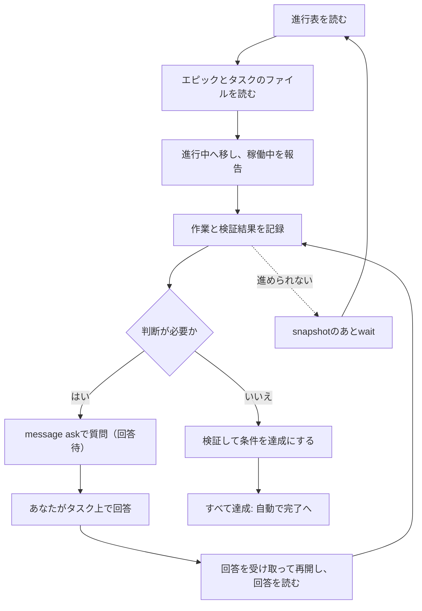

# エージェントとの連携

ここでは、エージェントに仕事を任せる方法を説明します。チャットで頼むと、エージェントが依頼を計画としてカンバンに置き（計画だけを頼んだときはバックログ）、決められないことを質問します。人が計画を未着手へ送ると（作業そのものを頼んだときはすぐに）、エージェントがタスクを順に進め、必要なときだけあなたのために止まります。エージェントはHookから進行表を受け取り、やったことを報告し、判断があなたのものであれば質問して回答を待ちます。このページでは、エージェントの設定方法と、作業のループ、任せる流れを説明します。[クイックスタート](../quickstart)で、この流れを一度体験できます。背景にある考え方は[仕事のモデル](../work-model)にあります。

## エージェントを設定する {#set-up-your-agents}

コンピューターごとに一度、`agpj setup`を実行します。Claude Code、Codex、または両方に、**Agent Projectプラグイン**を導入します。プラグインには、**Skill**（エージェントに作業の進め方を伝える`agent-project`）と、**Hook**（エージェントに進行表を渡す仕組み）が入っています。

```sh
agpj setup
```

`setup`はどのフォルダでも実行でき、プロジェクトは不要です。ターミナルでは次の順に進みます。

1. **エージェント。** `PATH`上の`codex`と`claude`を探します。見つからないエージェントは、理由とともに表示します。両方が見つかったときは、矢印キーで**Codex**、**Claude Code**、**Both**（両方）のいずれかを選び、Enterを押します。一方だけ見つかったときは、そのエージェントを使います。
2. **計画。** エージェントごとに、プラグインの導入や更新の内容、変更する設定ファイル、CodexのHookを信頼済みにするかどうか、自分で行う必要がある手順を表示します。
3. **確認。** 「**Apply these changes?**」と尋ねます。計画にCodexが含まれるときは、Agent ProjectのHookをCodexで信頼済みにすることも質問に書かれます。`y`を押すと実行します。それ以外の回答、Esc、Ctrl+Cでは何も変わりません。

4. **リモートアクセス（任意）。** プラグインを導入したあとに、スマホ用のリモート接続を今設定するかどうかを尋ねます。既定は「いいえ」です。「はい」と答えると、保存済みの内容を見せたうえで、ngrokとTailscaleのどちらでつなぐかを尋ねます。ngrokを選ぶと固定ドメインとngrokのトークン（入力は表示されません）を尋ね、Tailscaleを選ぶとTailscaleの準備ができているかを確かめ、足りないときは次の手順を示します。各質問は飛ばせます。これは[`agpj setup remote`](../reference/cli#save-the-remote-access-settings)と同じ手順で、あとから単独で実行することもできます。

終わったら、新しいエージェントのセッションを始めてプラグインを読み込ませます。そのあと、作業フォルダでプロジェクトを作成または登録します（[インストールと起動](../getting-started#create-or-bind-a-project)を参照）。

ターミナルがないときや`--json`を付けたときは、何も尋ねません。`--agent codex`、`--agent claude`、`--agent all`でエージェントを指定し、あらかじめ同意する`--yes`か、計画だけを表示する`--dry-run`を付けます。`--dry-run`は、何も導入、作成、変更しません。これらの実行では、リモートアクセスの手順は飛ばされます。

### setupが変更するもの

- **データフォルダ。** データフォルダと、その中の`shared`フォルダを作成します（[データとバックアップ](../operations/data)を参照）。
- **プラグイン。** エージェント自身のプラグインコマンドで導入します。マーケットプレイスは、`agpj`のバージョンのタグを指定したAgent Projectのリポジトリなので、プラグインは常にコマンドと同じバージョンになります。Codexでは`codex plugin marketplace add https://github.com/FooQoo/agent-project.git --ref vX.Y.Z`と`codex plugin add agent-project@agent-project`を、Claude Codeでは`claude plugin marketplace add https://github.com/FooQoo/agent-project.git#vX.Y.Z`と`claude plugin install agent-project@agent-project`を実行します。同じバージョンのプラグインが導入済みなら、何も導入しません。
- **共有フォルダへのアクセス。** Claude Codeでは、`~/.claude/settings.json`の`permissions.additionalDirectories`にデータフォルダを追加します。Codexでは、`~/.codex/config.toml`の`sandbox_workspace_write.writable_roots`に追加します。これが効くのは`sandbox_mode = "workspace-write"`のときだけです。ほかのモードや権限プロファイルを使っているときは、ファイルをそのままにして、自分で行う手順を表示します。サンドボックスのモードを変えることはありません。`danger-full-access`では何も必要ないので、何も書き込みません。
- **Codexでのagpjコマンド。** Codexが毎回確認せずに`agpj`を実行できるよう、`~/.codex/rules/agpj.rules`に`prefix_rule(pattern=["agpj"], decision="allow")`を書き込みます。すでにあるファイルはそのまま残します。`danger-full-access`では書き込みません。
- **CodexのHookの信頼。** Codexは、信頼済みのプラグインのHookだけを実行します。あなたが同意すると、setupはCodex自身の仕組みでAgent ProjectのHookを信頼済みにします。ほかのHookには触れません。

`CLAUDE_CONFIG_DIR`と`CODEX_HOME`を設定すると、Claude CodeとCodexのパスが変わります。設定ファイルを変更する前に、元のファイルの隣に`<name>.agpj-backup…`という名前でコピーを作ります。ほかの設定やコメントは残します。読めない設定ファイルがあるときは何も書き込まず、そのファイルを示します。

終了コードは、成功、変更なし、取り消しが`0`、エージェントの設定に失敗したとき、または設定できるエージェントがなかったときが`1`、コマンドラインが誤っているとき、またはターミナルがないのに必要なオプションがないときが`2`です。コマンドが見つからないエージェントは理由を示して飛ばし、もう一方のエージェントは設定します。

### Hookを信頼する

ファイルを書き込んでも、エージェントがそれを読み込んだとは限りません。setupのあと、Claude Codeは新しいセッションを始め、Codexは再起動してください。Claude Codeでは`/hooks`でHookを確認します。Codexでは、同意していればsetupがAgent ProjectのHookを信頼済みにしています。`/hooks`で確認できます。

### プラグインを更新する {#update-the-plugin}

`brew upgrade fooqoo/tap/agpj`のあと、プラグインは自分で更新されます。新しいエージェントのセッションが始まると、Hookが、エージェントが実行しているプラグインと、`agpj`が同梱するプラグインを比べます。違うときは、`agpj`のバージョンのタグからプラグインをバックグラウンドで入れ直し、エージェントがそのことを知らせます。新しいプラグインは、次のセッションから有効になります。何も尋ねません。Codexでは、更新がAgent Projectのhookも信頼済みにしますが、導入した定義が`agpj`の同梱するものと完全に同じときだけです。`agpj setup`での同意は、Agent Project自身のhookを信頼することを含みます。変わった定義や未知の定義は信頼しません。これは`agpj update`と同じ入れ直しなので、自分で実行することもでき、次の場合には必要です。

- **Codexで、hookの定義が`agpj`の同梱するものと違うとき。** Codexはプラグインのhookを、信頼したものだけ実行します。信頼はhookの定義に結び付きます。定義が変わることはまれで、自動更新が信頼するのは`agpj`が同梱する定義だけです。導入された定義が違うと何も信頼せず、エージェントが知らせるので、一度`agpj update`を実行してください（`setup`と同じ質問をします）。
- **自動更新が終わらなかったとき。** エージェントが、完了しなかったこと（たとえばGitHubに届かない）を知らせます。更新は6時間やり直しません。いま試すには`agpj update`を実行します。
- **プラグインが壊れている、または手で変更したとき。** `agpj update`は常に入れ直します。

自動更新を止めるには、エージェントの環境で`AGPJ_NO_PLUGIN_AUTO_UPDATE=1`を設定します。

```sh
agpj update
agpj update --yes
```

`update`は、プラグインが導入されたすべてのエージェントを対象にします。`--agent`で1つに絞れます。マーケットプレイスを新しいバージョンのタグに移し、新しいプラグインを導入し、新しいCodexのHookを信頼し直します。`setup`と同じように計画を表示して確認します。`--yes`はあらかじめ同意し、`--dry-run`は計画だけを表示します。設定ファイルは変更しません。プラグインがないエージェントは、`agpj setup`を実行するよう示して飛ばします。


### Hookが行うこと

- **フォルダの解決。** Hookのコマンドは固定の`agpj hook --agent claude`で、プロジェクト名もセッションIDもありません。入力の`cwd`を読み、最も近い登録済みの祖先フォルダを使います。明示した`--project NAME`はフォルダの登録より優先されます。登録がまったくないフォルダはエラーではありません。Hookは何も出力せず正常終了するので、Hookがほかのフォルダでの作業を妨げることはありません。壊れた登録、削除されたプロジェクト、読めない`cwd`では`AGPJ_ERROR`を返し、Hookが別のプロジェクトを推測することはありません。
- **進行表。** Hookは、`agpj progress`と同じ簡潔な表を渡します。完了・アーカイブ済み・回答待のタスクは、Hookのコマンドに`--include-awaiting-answer`や`--include-done COUNT`を付けない限り含みません（[エピックと進行表](../watch/epics)を参照）。表が256 KiBを超える、または読めないときは、エージェントに`AGPJ_ERROR`が渡され、プロジェクトの情報に依存する変更をしてはいけません。
- **ターン終了時のチェックリスト。** エージェントがターンを終えるとき、Hookは短いルールの一覧を確認し、項目が出れば、止まる前にチェックリストを一度だけ返します。`Found`の下の項目（`NG:`）はHookが確かめた違反、`Check`の下の項目（`[ ]`）はこのターンで引き金が引かれたもので、当てはまるかどうかはエージェントが判断します。カンバンではなくチャットだけに出した質問と、記録されていない成果（実行中のタスクがあるのにプルリクエストを作った、pushした、画像を書いた、または完了したタスクに最終成果がない）が対象です。ターンごとに最大1回で、プロジェクトのないフォルダでは何もしません。Codexではこのhookを信頼する必要があるので、更新後に`agpj update`を実行してください。

### エージェントが編集してよいもの

- エージェントが編集してよいのは、プロジェクトの`README.md`が許す範囲で、下書きでないタスクの`TASK.md`と、エピックの`EPIC.md`だけです。
- `task.json`はメタデータを持ち、CLIで変更します。`TASK.md`は本文・完了条件・履歴を持ちます。
- タスクの操作は履歴を自動で追加します。状態を変える判断は移動や状態変更の`--reason`に書き、状態を変えないが後で効く判断だけを`history add`で一度記録します。計画と簡潔な検証結果は本文に置きます。
- エージェントは、`epic.json`や`project.json`を編集せず、タスクやエピックのフォルダを削除せず、共有ファイルにマシン固有の絶対パスを書きません。

形式は[Markdownファイルの形式](../reference/file-format)にあります。

AIは履歴をタスク本文と同じ言語で記録します。ブラウザ操作で自動生成する履歴は、選択した画面言語を使います。CLI操作と自動完了では、本文に日本語の文字があれば日本語、それ以外は英語にし、本文が空か標準テンプレートならタイトルを使います。保存済みの履歴や入力した理由は変わりません。

## 作業の流れ



1. **選ぶ。** `agpj progress --json`を読み、エピックに保存されたタスクの順序に従って、進められるAI担当のタスクを選びます。選んだエピックの`EPIC.md`とタスクの`TASK.md`だけを読み、履歴や未回答の質問が必要なときは`show`を使います。
2. **始める。** タスクを理由つきで進行中に移し、稼働中を報告します。ユーザー担当のタスクは、作業に関わるときだけ確認します。
3. **作業して記録する。** 移動や状態変更の根拠は、その`--reason`に書きます。自動で残る項目が記録の唯一の一回分です。`history add`は、TODOに据え置くなど状態を変えないが後で効く判断にだけ使い、根拠・判断・分かっていれば再検討の条件を添えます。一覧を見ただけでは追記せず、`result add`は自動で記録されます。計画と簡潔な検証結果は本文に置き、見た目の確認が有用な場合は画像を添付します。
4. **詰まったら尋ねる。** 判断が必要なときは`message ask`で質問します。回答するまで、タスクは回答待と表示され、稼働中のタスクは質問を結び付けた時点で自動的に稼働待になります（[判断依頼](./decisions)を参照）。エージェントが自分でタスクを稼働待にすることはありません。
5. **再開する。** エージェントが回答を受け取ると、AI担当の進行中の稼働待のタスクは、参照する質問がすべて回答済みであれば自動で稼働中に戻ります。ほかの参照先の質問が未回答なら稼働待のままです。エージェントはタスクを読み直し、まだ自分が進めるべきタスクである場合だけ続けます。人が一時停止したり別の列へ動かしたりしていれば、それを尊重し、タスクの現在の状態に従います。そのうえで履歴を読み、計画を考え直します。
6. **終える。** 完了条件は、検証が済んでから達成にします。条件がすべて達成になると、対象のAI担当タスクは自動で完了に移ります。エージェントが進行中のタスクを未着手に戻すことはありません。
7. **待つ。** 進められる作業がないときは、変更を待ちます（下を参照）。

進行表は[エピックと進行表](../watch/epics)を参照してください。

AIは編集できるAI担当タスクを読んだあと、タイトルが分かりにくければ、着手前に対象と変更内容が伝わる短いタイトルへ整理します。元の依頼文と添付画像は保持し、すでに分かりやすいタイトルは変えません。これは、リッスン中も含めて、AIのセッションの中で行う動作です。フォームから登録したときのタイトルは、これまでどおり依頼の最初の空でない行です。完了したタスクのタイトルをAIが変えることはありません。

### 依頼をタスクに分ける

1枚のタスクに収まらない作業を頼むと、エージェントは何を頼まれたかを判断します。計画だけを頼んだ場合は、計画をバックログに置きます。目的・範囲・完了条件を書いたエピックと、進める順に並べたタスクです。バックログのカードは「始めない」という意味なので、あなたが未着手へ送るまで何も始まりません（[バックログとエラー](#バックログとエラー)を参照）。作業そのものを頼んだ場合は、通常の未着手のタスクを作り、質問への回答がそろえば、開始の承認を求めずに進めます。エージェントに渡るのは、未着手で着手できる状態のタスクだけです。計画だけか作業までかが分からないときは、計画を作る前に質問で確かめます。その回答はカンバンに残るので、エージェントの再起動後も別のセッションでも同じです。バックログのカードへの質問には答えられ、計画はチャットで直せますが、そのカードの作業は、あなたが未着手へ送るまで渡されません。バックログのレーンが付く先のリリースまでは、バックログのカードは**下書き**バッジの付いた通常の未着手のカードとして表示され、エージェントが質問しているあいだ、開いて計画を読めます。

1. **計画についての質問。** エージェントは、計画について自分で決められないことを、選択肢と推奨を添えた通常の質問として尋ねます。未回答の質問を参照するタスクは、回答するまで**回答待**と表示されます。
2. **計画の手直し。** エージェントは、答えに合わせてエピックとタスクを直します。まだ決まらないことがあれば、さらに尋ねます。
3. **送信。** バックログの計画を未着手へ送れるのはあなただけです。エピックには`agpj epic send <EPIC-ID> --actor human`、1つのタスクには`agpj mv <id> todo --actor human`を使います。エージェントが行うと`human_only`になります。タスクに紐づく質問が未回答のあいだは、`--force`で確認するまで送信が断られます（`send_with_open_questions`）。履歴には「人が Todo へ送りました。」と残ります。
4. **作業。** 送信後は、エージェントがエピックの順にタスクを進め、そのたびには尋ねません。

開始後にエージェントがあなたを呼ぶのは、次の場合だけです。

- あなたの意図が不明確で、読み方によって結果が変わるとき
- 見た目や文言、何を先にするかなど、あなたの好みで決まるとき
- 削除、公開、外部への送信など、元に戻せない操作をするとき
- 作業が、頼まれた範囲より大きいとわかったとき

それ以外はエージェントが自分で判断し、判断のたびにタスクの履歴に残します。あなたの回答を待っている間も、答えに左右されない部分の作業は進められます。

あなたが自分でカンバンに置いたタスクは下書きではなく、開始の操作は要りません。

### 質問

記録を一か所に保つため、エージェントの質問はいつもカンバンに置かれ、選択肢が付きます。会話をしている間は、同じ質問を選択肢とおすすめ付きの文章としてチャットにも書き、カンバンにも同じ質問があることを伝えます。エージェント自身の質問ダイアログは開きません。開くと、カンバンで答えたことにエージェントが気づけなくなるためです。答えやすいほうで答えてください。

- **チャットで答える。** 自分の言葉で返信してください。エージェントが、その言葉を`message answer --via chat`でカンバンに回答として記録し、作業を続けます。エージェントが自分で質問に答えることはありません。
- **カンバンやスマホで答える。** [判断依頼](./decisions)を参照してください。

先に記録された回答が採られ、エージェントは同じ質問をもう一方の場所で尋ね直しません。カンバンで答えたあと、チャットで違う答えをすると、エージェントはどちらの回答が記録されたかを伝え、その回答で作業を続けます。

エージェントは、すべての質問に答えが付くまで`message ask`を動かし続けます。1回の待機は最長10分で、時間切れになると同じ質問を待ち直します。待ち方はエージェントによって異なります。

- **Claude Code**は裏で待ち、そこで発言を終えます。カンバンで答えると待機が終わってエージェントが起こされ、あなたがメッセージを送らなくても作業を続けます。チャットで返信したときは、エージェントがその返信を記録して続けます。
- **Codex**は、質問をチャットに書いたあと手前で待ちます。カンバンで答えるか、エージェントを中断してチャットで返信してください。返信はエージェントが記録します。

エージェントのチャットでの返信は、あなたが話しかけている言語で書かれます。カンバンの設定画面で英語以外の言語を選んでいると、進捗表にもその言語が手がかりとして載り、英語のツール出力が長く続いたあとも、エージェントはあなたの言語で返答し続けます。会話であなたが使う言語が常に優先されます。タスクの待ち受けのように会話に人がいないときは、カンバンだけで尋ねます。

質問を登録してすぐに戻るよう明示された場合にだけ、`--no-wait`を使います。Agent Projectのサーバーに接続できないときは問題を報告し、カンバンで質問できるようになるまで待ちます。

## 変更を待つ

```sh
agpj --project "My project" snapshot --json
agpj --project "My project" wait --after "<cursor>" --json
```

cursorの形式は`f1:<project-id>:<version>`です。`snapshot`が返す値を使い、自分で組み立てないでください。

- `wait`は、同じデータ領域のサーバーを必要とします。動いていなければ裏で起動し、ポーリングせずに変更を待ちます。
- `wait`、回答を待つ質問、Hookが裏で起動したサーバーは、カンバンのタブがつながっていなければ、そのプロジェクトのカンバンをブラウザーで一度だけ開きます。開かないときと`agpj open`については、[カンバンをブラウザーで開く](../reference/cli#open-the-board-in-the-browser)を参照してください。
- 名前変更をまたいで同じプロジェクトを追うので、以後のコマンドとHookでは新しい名前を使います。ほかのプロジェクトの変更では終わりません。プロジェクトが削除されると、`project_not_found`で失敗します。
- `wait_timeout`・`board_unavailable`・`cursor_invalid`・`project_not_found`はエラーで、回答ではありません。
- `wait`が返ったら、スナップショットと履歴をすべて読み、ユーザーの理由を考慮して、再開するか、追加の質問をします。

## 次のタスクを待つ {#listen-for-the-next-task}

起動済みのCodexまたはClaude Codeのセッションを一つ使い、同じプロジェクトのAI担当タスクを順番に進められます。明示的にリッスンを始め（同じデータ領域のサーバーが動いていなければ、コマンドが起動します）、対象がない状態が何秒続いたらコマンドを終えるか指定します。

```sh
agpj --project "My project" wait --until task --idle-timeout 300 --json
```

待機秒数は必須で、1〜86,400秒を指定します。既定値はありません。未着手にあるタスクはすぐに返されるので、リッスンを始める前に作ったタスクも対象です。進行中にあるAI担当タスクも、`agentStatus`が`idle`または`paused`なら対象です。

リッスンを始めるときと再開するときは、AI担当タスクの`agentStatus`を確認します。`running`のタスク、または未着手か進行中にあって`awaitingAnswer`が真のタスクがあれば、その作業を先に解決します（バックログや完了にあるAI担当タスクの未回答の質問は、そのままにします）。30分履歴が増えていない稼働中のタスクは、止まっているものとして`nextTasks`の先頭に載ります。エージェントはその作業を続けるか、続けられない理由を`history add`で記録します。進行中のタスクがあるだけでは、リッスンは止まりません。

一回の呼び出しで返すのは一件です。そのタスクを終えてから、同じセッションで`wait`をもう一度呼び出して次へ進みます。対象の順序は進行表と同じで、エピックのID順に、各エピックの保存済みのウェーブ順とタスクID、最後にエピックに属さないタスクのID順です。対象になるのは、AI担当で、未着手か進行中にあり、`agentStatus`が`idle`か`paused`で、回答待ではなく、下書きでもアーカイブ済みでもないタスクだけです。

`wait`はタスクを占有も変更もしません。作業が承認されていて始められるかを判断する前に、エピックの`EPIC.md`（ある場合）、本文、添付、最新の状態を読んでください。`agpj add`で作ったタスクも、あとからリッスンで取得されます。

回答待の判断依頼の扱いや、中断後の復帰方法を含む全体の手順は、agent-projectスキルのリッスン手順（`agpj skills listening`で出力）を参照してください。

セッションが未着手か進行中で進めているタスクが回答待のときは、別のタスクに移らず、その回答が届くまで同じセッションで待ちます。待っている時間は対象なしの時間に数えません。バックログや完了にあるAI担当タスクの未回答の質問は、そのままにして、リッスンは他の作業を続けます。回答が受け取られたあとは、`agpj skills waiting`の「回答のあと」の手順に従います。進行中の稼働待のタスクは自動で稼働中に戻り、人が一時停止したり別の列へ動かしたりしていれば、タスクの現在の状態に従います。そのあとで、次のタスクを待ちます。

エージェントはタスクを一時停止できません。人を待つときは質問を出してタスクを回答待と表示させ、それ以外の理由で進められないときは、理由を`history add`で記録します。

コマンドを自分で入力せずにセッションにAgent Projectからの依頼を待たせるには、プラグインの`wait`スキル（Claude Codeでは`/agent-project:wait`）を呼び出します。リッスン手順に従い、待機秒数を指定しなければ3600秒を使い、`idle_timeout`のたびに待ち直すので、中断するかエラーで止まるまでセッションは張り付いたままです。回答と依頼をタスクより先に処理します。

`idle_timeout`は終了コード0の正常終了です。指定した時間に対象タスクがなかったことだけを示します。サーバー切断、不正なプロジェクトデータ、プロジェクト削除、引数の誤りはエラーであり、対象なしとして報告してはいけません。出力とエラーコードは[CLIリファレンス](../reference/cli#変更またはタスクを待つ)を参照してください。

## Agent Projectが起動するセッション {#sessions-the-board-starts}

自分でエージェントを起動する代わりに、Agent Projectが、プロジェクトのフォルダで、画面を持たないClaude CodeまたはCodexのセッションを起動できます。起動したセッションはAgent Projectからの依頼を待ち受け、渡された仕事に取り組みます。Agent Projectは、あなたの依頼、セッション自身の質問への回答、着手可能なタスクを、セッションが待機中のときだけ1つずつ送るので、`wait`コマンドを実行したり動かし続けたりする必要はありません。ターミナルで自分で起動したセッションは、これまでどおり`agpj wait`で依頼やタスクを待ちます。ツールやプロジェクトによらず、Agent Projectが起動できるセッションは同時に1つまでです。サーバーの`PATH`に`claude`または`codex`のコマンドがあり、そのツールにログインしている必要があります。

> **警告: Agent Projectが起動したセッションは誰も見ておらず、承認は自動です。** Claude Codeはautoモードで動きます。レビュアーが各操作を確認し、あなたに確認が必要になる操作は、代わりに拒否されます。Codexはworkspace-writeのサンドボックスと自動レビューで動き、エージェントが`agpj`を使えるよう、Agent Projectのデータフォルダが書き込み可能として加えられます。どちらも、あなたに確認するために止まりません。自動レビューは、あなたなら承認しない操作を承認することがあり、タスクやエージェントが読むWebページに書かれた誤った指示が、害を及ぼすこともあります。信頼できるプロジェクトでだけ起動し、終わったらカンバンから止めてください。Agent Projectのサーバーが止まるときは、起動したセッションも止めます。

このセッションを起動・停止できるのは、あなたのコンピューターのカンバンだけです。スマホからの接続からはできません。エージェントの出力は、データフォルダの`resident/<ツール>.log`に書かれます。起動のたびに新しいファイルになり、直前の4回分は`<ツール>.1.log`〜`<ツール>.4.log`として残ります。エージェントが止まったとき・終了したときは、その時刻と理由（あなたの停止、再起動、モデルの変更、サーバーの終了、予期しない終了など）はサーバーの標準エラー出力に書かれます。バックグラウンドのサーバー（`serve -d`）ならデータフォルダの`serve.log`に、フォアグラウンドのサーバーなら端末に出ます。

## バックログとエラー

人が書いている下書き（`draft: "human"`）は、エージェントからは読み取り専用です。`edit`・`mv`・`state`・`history add`は`task_is_draft`で失敗します。ユーザーが確定するまで、ほかのタスクを進めます。

バックログのカードに対して、エージェントの`mv`と`state`は`task_in_backlog`で失敗しますが、`edit`と`history add`は使えます。エージェントが`add --actor ai --backlog`でバックログのカードを作るのは計画だけを頼まれたときで、`--backlog`なしの`add`は、ユーザー向けのものも含めて、通常の未着手のタスクを作ります。カードを未着手へ送れるのは人だけです（`mv <id> todo`・`epic send`）。エージェントの`mv <id> todo`・`epic send`は`human_only`で失敗します。

`AGPJ_ERROR`が出た場合や、プロジェクトが見つからない・接続できない・カンバンを読み込めない場合は、その問題を報告します。有効な進行表を取得できるまで、プロジェクトの情報に依存する変更は行いません。待機が時間切れになったり中断されたりしても、質問は未回答のまま残ります。原因と対処は[トラブルシューティング](../operations/troubleshooting)を参照してください。

## 次に読む

- [CLIリファレンス](../reference/cli): エージェントが使うすべてのコマンド。
- [判断依頼](./decisions): エージェントの尋ね方と、あなたの答え方。
