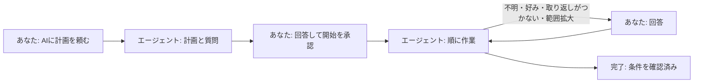
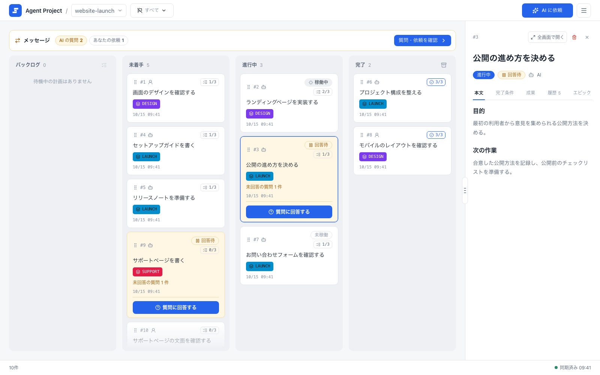

# はじめに

<video class="demo-video" :src="withBase('/videos/demo.ja.mp4')" :poster="withBase('/videos/demo.ja.jpg')" autoplay muted loop playsinline></video>

Agent Projectは、人が回さなくても大きな仕事が進むようにします。**AI に依頼**で計画を頼み、開始を承認し、途中で出てくる決定に答えます。受け取るのは、完了条件に照らして確かめた結果で、タスクのすべての完了条件を確かめると、そのタスクは自動で完了へ移ります。

実際に触ってみたい場合は、[デモを試す](https://fooqoo.github.io/agent-project/demo/)からブラウザで操作できます。インストールは不要です。サンプルデータで初回の案内が始まります。ブラウザの言語が日本語なら日本語で、それ以外なら英語で表示されます。ページを再読み込みすると最初からやり直せます。

## 課題: 長い仕事には、回し役が要る

大きな仕事をAIエージェントに渡しても、最後まで一人で走りきることはまれです。途中で迷い、止まり、終わったつもりになるので、要望を計画に直す、止まったり脱線したりしていないかを見る、チャットに流れた質問を拾う、新しいセッションで経緯を説明し直す、終わったかどうかを最後に確かめる、といった作業を人が担うことになります。エージェントが働いている間も、人は回し続けることになります。

Agent Projectは、この回し役を減らすためのものです。エージェントを動かすのではなく、エージェントに足りないプロジェクトマネジメントを与えます。依頼を伝え、聞かれたときに答え、それ以外の時間は離れていられるようにします。CodexやClaude Codeを使って一人でプロダクトを作っている人のためのものです。

## Agent Projectとは: エージェントのためのプロジェクトマネジメント

Claude CodeやCodexのようなエージェントには、動くための道具、コンテキスト、実行のループがすでにあります。足りないのは、仕事のまわりにあるプロジェクトのモデルです。Agent Projectは、その層にあたり、エージェントとあなたで共有します。エージェントが計画し報告し、あなたが答えます。次の4つを一か所で持ちます。

- **順番のある計画。** 目標がエピックとタスクに分かれます。エピックが仕事をまとめて順序を決め、タスクが単独でレビューできる作業の単位になります。エージェントは順序を読んで次にやることを知ります。
- **終わりの定義。** 各タスクが、何を満たせば終わりかを完了条件として先に宣言します。エージェントは、確かめてから完了にします。
- **止まって聞く質問。** 判断があなたのものであるとき、エージェントは自分で決めず、選択肢を添えて質問し、待ちます。質問と回答は、どのモニターから答えても一つだけ記録されます。
- **やったことと決めたことの記録。** 移動、質問、回答、確認のすべてが理由つきで履歴に残り、結果に成果が残ります。新しいセッションや別のエージェントは、前の続きから始められ、あなたも何が起きたかを後から辿れます。

データはすべて手元のマシンに通常のファイルとして保存され、あなたもエージェントも同じファイルを読み書きします。要素・状態・Agent Projectが守ることは、[仕事のモデル](./work-model)で説明します。

## 任せる流れ

計画を書くのはあなたではありません。頼めば、エージェントがボード上で計画します。

1. **AIに計画を頼む。** やりたいことを、ボードの**AI に依頼**か、エージェントのチャットで、普通の言葉で伝えます。
2. **計画が置かれる。** エージェントが、エピックと、作業順に並べたタスク（それぞれに完了条件つき）を計画としてボードに置き、自分では決められないことを質問します。
3. **開始を承認する。** 質問に答えると、計画が未着手へ進みます。計画だけを頼んだ場合、計画はバックログで待ち、あなたが送ってはじめて進みます。作業そのものを頼んだ場合は、そのまま未着手に入ります。そのタスクに紐づく質問が未回答のあいだは始まりません。
4. **途中で答える。** エージェントはタスクを順に進め、やったことを記録し、それ以外のことは自分で決めます。あなたを呼ぶのは、意図が分からないとき、好みで決まるとき、取り消せない操作をするとき、頼まれた範囲を超えるときの4つだけです。
5. **結果を受け取る。** エージェントがタスクのすべての完了条件を確かめ、あなたを待つものがなくなると、タスクは自動で完了に移り、やったことと決めたことは履歴と結果に残ります。

[クイックスタート](./quickstart)で一度体験でき、[エージェントとの連携](./delegate/agents)で詳しく説明しています。

### 作り込む前にアイデアを試す

たとえば、二画面に分かれた会員登録を一画面にまとめる案があるとします。Claudeに相談して試すと決めたら、エージェントに「今の入力項目のまま、操作できる一画面のモックを作って。スマホ幅で今の画面と見比べられるように、両方のスクリーンショットも付けて」と頼みます。このタスクの完了条件は、そのモックと比較用の画像がそろうことです。

実際に触ってみて、フォームが縦に伸びて登録ボタンが見えにくければ、二画面のままにして、次は任意の入力項目を一つ減らす手もあります。本実装に時間をかける前に、比較した結果をもとに判断できます。

## 見守り方と答え方

ボードは、仕事を見るモニターの一つです。モニターは見るだけの場所ではなく、スマホ、チャット、CLIからも同じ仕事を見て、答えて、介入できます。どこから見ても、関わり方は二つあります。

- **聞かれたら答える（Human-in-the-Loop）。** エージェントが判断を求めて止まったとき、ボード、スマホ、チャット、CLIのどこからでも答えられます。答えは一度だけ記録され、エージェントは作業を再開します。[判断依頼](./delegate/decisions)を参照してください。
- **見守って介入する（Human-on-the-Loop）。** エージェントは動き続け、あなたはそれを見ます。カードを差し戻す、完了条件にチェックを付ける、計画を書き換える。エージェントは、次にボードを読むときにその変更に従います。[ボード](./watch/board)を参照してください。

{.screenshot}

ボードには、未着手・進行中・完了の列があります。この画面では、進行中のタスクがあなたの回答を待っていて、各タスクには完了条件の達成数が表示されています。外出先では、[リモートアクセス](./watch/remote-access)で同じ仕事をスマホから見られます。エージェント自身のモニターはチャットで、`agpj`コマンドはエージェントやスクリプトが使う入口です。

## どこから読むか

はじめてなら、最初の4ページを順に読んでください。

1. [インストールと起動](./getting-started): `agpj`をインストールし、エージェントを設定して、ボードを開きます。
2. [クイックスタート](./quickstart): 最初の仕事を任せ、完了まで見届けます。
3. [仕事のモデル](./work-model): 操作の前提となる考え方を理解します。
4. [エージェントとの連携](./delegate/agents): エージェントが計画し、質問し、完了する流れを知ります。

## 目的から探す

| したいこと | 読むページ |
| --- | --- |
| エージェントに仕事を任せる | [クイックスタート](./quickstart)と[エージェントとの連携](./delegate/agents) |
| エージェントの質問に答える | [判断依頼](./delegate/decisions) |
| タスクを追加・移動・確認する | [ボード](./watch/board) |
| タスクをまとめ、次にやることを見る | [エピックと進行表](./watch/epics) |
| タスクを書き、画像を添付する | [編集と画像添付](./watch/editing) |
| プロジェクトのMarkdown文書を読み、編集する | [プロジェクトのドキュメント](./watch/docs) |
| スマホからボードを確認する | [リモートアクセス](./watch/remote-access) |
| コマンドを調べる | [CLIリファレンス](./reference/cli) |
| `TASK.md`や`EPIC.md`を手で編集する | [Markdownファイルの形式](./reference/file-format) |
| ファイルの場所を知る、バックアップを取る | [データとバックアップ](./operations/data) |
| うまくいかないことを直す | [トラブルシューティング](./operations/troubleshooting) |

Agent ProjectプラグインがClaude CodeとCodexに導入するものは、[プラグインのガイド（英語）](https://github.com/FooQoo/agent-project/blob/main/plugins/agent-project/README.md)を参照してください。Agent Project自体を変更したいときは、[開発者ガイド](../dev/)を読んでください。
